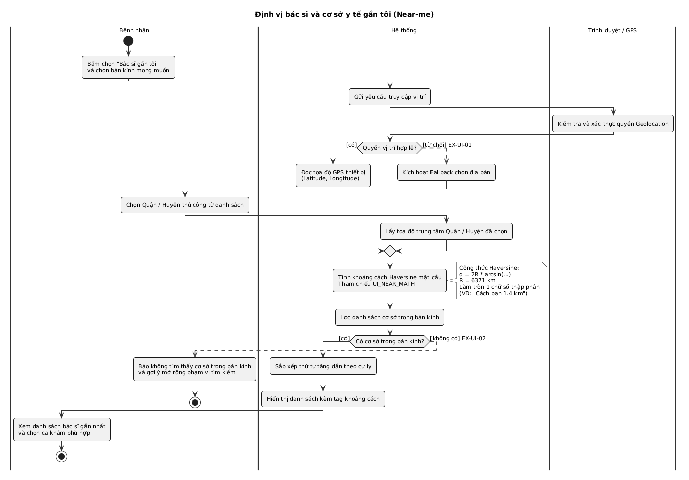

# ĐẶC TẢ NGHIỆP VỤ & KỸ THUẬT TÍNH NĂNG ĐỊNH VỊ BÁC SĨ GẦN TÔI (UI_NEAR)

- **Dự án:** MedSi — Đặt lịch khám bệnh trực tuyến (IS207)
- **Phân hệ phụ trách:** Giao diện & Trải nghiệm Người dùng (`UI — User Interface & UX`)
- **Mã tài liệu:** `UI_NEAR` / `ACT-UI-01`
- **Người thực hiện:** **Huy Nguyễn Quốc**
- **Ngày hoàn thành:** 15/10/2026
- **Bản vẽ sơ đồ đối chiếu:** [ACT-UI-01.png](UI_ACT/ACT-UI-01.png) • [ACT-UI-01.puml](UI_ACT/ACT-UI-01.puml)
- **Đường dẫn test ứng dụng trực tiếp:** [http://localhost:5173/doctors?near=true](http://localhost:5173/doctors?near=true)

---

## 🧭 1. Bối Cảnh, Động Lực & Mục Tiêu Nghiệp Vụ

### 1.1. Bài toán thực tế của người bệnh
Khi gặp triệu chứng sức khỏe bất thường, bệnh nhân thường hoang mang không biết phòng khám nào gần nhà mình có bác sĩ chuyên khoa giỏi. Nếu đến bệnh viện tuyến đầu không đúng lịch hẹn, họ phải xếp hàng bốc số nhiều giờ trong mệt mỏi.

### 1.2. Hạn chế của các nền tảng y tế đối thủ
- **YouMed:** Chỉ hỗ trợ lọc theo danh mục Quận/Huyện dạng Dropdown tĩnh, không thể đo khoảng cách thực tế (km) từ vị trí thiết bị.
- **Medpro:** Chỉ phân cấp theo Tỉnh/Thành phố lớn (TP.HCM, Hà Nội, Đà Nẵng).
- **BookingCare:** Hoàn toàn không hỗ trợ tính năng định vị cự ly.

### 1.3. Mục tiêu thiết kế của MedSi
1. **Tự động hóa hoàn toàn:** Nhận diện vị trí GPS của bệnh nhân chỉ với 1 chạm.
2. **Đo khoảng cách chuẩn xác:** Áp dụng công thức Haversine mặt cầu WGS84, làm tròn 1 chữ số thập phân (`X.X km`).
3. **Ước tính thời gian:** Tự động tính thời gian di chuyển bằng xe máy trong nội đô (`~5 phút đi xe`).
4. **Cơ chế Fallback thông minh (EX-UI-01):** Nếu bị từ chối GPS hoặc không có HTTPS, tự động mở Modal chọn 1 trong 11 Quận/Huyện thủ công.
5. **Bán kính linh hoạt:** 4 nấc lọc: `< 2 km`, `< 5 km` (mặc định), `< 10 km`, `< 20 km`.

---

## 🔄 2. Sơ Đồ Quy Trình Hoạt Động (Activity Diagram — ACT-UI-01)

| Bước | Tác tử thực hiện | Hành động chi tiết |
| :---: | :---: | :--- |
| **1** | Bệnh nhân | Bấm chọn nút 'Bác sĩ gần tôi' trên Hero Banner hoặc thanh công cụ tìm kiếm. |
| **2** | Hệ thống | Gọi Geolocation API trình duyệt `navigator.geolocation.getCurrentPosition()` với timeout 8000ms. |
| **3** | Trình duyệt / GPS | Xác thực quyền truy cập vị trí của thiết bị. |
| **4a** | Hệ thống | **[Có quyền]:** Đọc tọa độ GPS thiết bị (Latitude, Longitude). |
| **4b** | Hệ thống & Bệnh nhân | **[Từ chối - EX-UI-01]:** Kích hoạt Modal Fallback; Bệnh nhân chọn Quận/Huyện thủ công; Lấy tọa độ trung tâm quận. |
| **5** | Hệ thống | Tính khoảng cách Haversine mặt cầu đến từng phòng khám theo bán kính $R = 6371\text{ km}$. |
| **6** | Hệ thống | Lọc cơ sở trong bán kính chọn và sắp xếp thứ tự tăng dần theo cự ly gần nhất. |
| **7a** | Bệnh nhân | **[Có kết quả]:** Xem danh sách bác sĩ gần nhất kèm tag cự ly `Cách bạn X.X km • ~Y phút đi xe` và chọn ca khám. |
| **7b** | Hệ thống & Bệnh nhân | **[Không có kết quả - EX-UI-02]:** Hiển thị Empty State kèm nút gợi ý 'Mở rộng lên 10 km / 20 km'. |

---

## 🧮 3. Cơ Sở Toán Học Tính Cự Ly Haversine Mặt Cầu

### 3.1. Công thức toán giải tích
Khoảng cách giữa hai điểm $P_1(\phi_1, \lambda_1)$ và $P_2(\phi_2, \lambda_2)$ trên mặt cầu Trái Đất:

$$\Delta\phi = \phi_2 - \phi_1, \quad \Delta\lambda = \lambda_2 - \lambda_1$$

$$a = \sin^2\left(\frac{\Delta\phi}{2}\right) + \cos(\phi_1)\cos(\phi_2)\sin^2\left(\frac{\Delta\lambda}{2}\right)$$

$$c = 2 \cdot \text{atan2}\left(\sqrt{a}, \sqrt{1 - a}\right)$$

$$d = R \cdot c$$

- **Bán kính Trái Đất chuẩn WGS84:** $R = 6371\text{ km}$.
- **Độ chính xác:** Sai số trong nội thành $< 0.3\%$.

### 3.2. Quy tắc hiển thị (BR-UI-10)
- Nếu $d \ge 0.1\text{ km}$: Làm tròn 1 chữ số thập phân: `d.toFixed(1) + ' km'` (VD: `1.4 km`, `3.8 km`).
- Nếu $d < 0.1\text{ km}$: Hiển thị `< 100 m`.
- Thời gian di chuyển: $t = \max(2, \text{round}(d / 22 \times 60))$ phút (với vận tốc đô thị $v \approx 22\text{ km/h}$).

---

## 📍 4. Danh Mục 11 Tọa Độ Quận/Huyện Fallback (EX-UI-01)

| Mã | Quận / Huyện | Vĩ độ (Lat) | Kinh độ (Lng) | Mốc hành chính trung tâm | Cơ sở MedSi lân cận |
| :---: | :--- | :---: | :---: | :--- | :--- |
| **q1** | **Quận 1, TP.HCM** | `10.7758` | `106.7009` | UBND Quận 1 / Bến Nghé (Mặc định) | MedSi Clinic Q1 (1.1 km) |
| **q3** | **Quận 3, TP.HCM** | `10.7843` | `106.6845` | Nam Kỳ Khởi Nghĩa / CMT8 | MedSi Skin Q3 (0.5 km) |
| **q5** | **Quận 5, TP.HCM** | `10.7540` | `106.6634` | Cụm BV Chợ Rẫy / ĐHYD / Hùng Vương | BV ĐHYD & Chợ Rẫy (0.6 km) |
| **q10** | **Quận 10, TP.HCM** | `10.7716` | `106.6669` | Sư Vạn Hạnh / BV Nhi Đồng 1 | BV Nhi Đồng 1 & BS Tâm (0.2 km) |
| **q11** | **Quận 11, TP.HCM** | `10.7630` | `106.6508` | Đầm Sen / Lãnh Binh Thăng | Giáp ranh Quận 5, 10 |
| **binhthanh** | **Bình Thạnh, TP.HCM** | `10.8030` | `106.6993` | Điện Biên Phủ / BV Gia Định | MedSi Clinic Bình Thạnh (0.4 km) |
| **phunhuan** | **Phú Nhuận, TP.HCM** | `10.7992` | `106.6803` | Phan Xích Long / Hoàng Văn Thụ | Cụm phòng khám nội thành |
| **tanbinh** | **Tân Bình, TP.HCM** | `10.8014` | `106.6528` | Hoàng Hoa Thám / Sân bay TSN | Cụm phòng khám Tân Bình |
| **govap** | **Gò Vấp, TP.HCM** | `10.8388` | `106.6653` | Quang Trung / Nguyễn Oanh | Nội thành phía Bắc |
| **thuduc** | **TP. Thủ Đức, TP.HCM** | `10.8494` | `106.7716` | Khu đô thị sáng tạo phía Đông | BV Đa Khoa KV Thủ Đức |
| **q7** | **Quận 7, TP.HCM** | `10.7340` | `106.7218` | Phú Mỹ Hưng / BV FV | Cụm y tế quốc tế Nam Sài Gòn |

---

## 🎛️ 5. Bộ Lọc Bán Kính Chuẩn BR-UI-08 & BR-UI-23
- `< 2 km`: Đi bộ hoặc 5 phút xe máy, dành cho trường hợp khẩn cấp hoặc người không có phương tiện.
- `< 5 km` *(Mặc định)*: Khoảng cách di chuyển xe máy lý tưởng nội đô (10 - 15 phút).
- `< 10 km`: Mở rộng cự ly liên quận để tiếp cận chuyên gia đầu ngành tuyến trung ương.
- `< 20 km`: Kết nối bệnh nhân khu vực ngoại thành vào bệnh viện lớn.
- `Tất cả`: Không giới hạn cự ly nhưng vẫn hiển thị tag khoảng cách sắp xếp tăng dần.

---

## 🧪 6. Kịch Bản Kiểm Thử & Nghiệm Thu (Test Cases)

| Mã TC | Kịch bản kiểm thử | Thao tác thực hiện | Kết quả mong đợi | Trạng thái |
| :---: | :--- | :--- | :--- | :---: |
| **TC-NEAR-01** | Cấp quyền GPS thành công | Bấm 'Lấy GPS tự động', chọn 'Allow' | Đọc tọa độ GPS, gắn tag `Cách bạn X.X km`, sắp xếp tăng dần cự ly | **PASS** |
| **TC-NEAR-02** | Từ chối quyền GPS (EX-UI-01) | Chọn 'Block' quyền định vị trên trình duyệt | Bật Modal Fallback 'Chọn Khu Vực Của Bạn', chọn Quận 1 ➔ đo từ Quận 1 | **PASS** |
| **TC-NEAR-03** | Lọc bán kính 2km / 5km / 10km | Bấm chuyển đổi chip bán kính | Danh sách tự động lọc dưới 150ms | **PASS** |
| **TC-NEAR-04** | Trạng thái rỗng (EX-UI-02) | Chọn bán kính < 2km tại vị trí xa | Hiển thị Empty State kèm nút 'Mở rộng lên 10 km / 20 km' | **PASS** |
| **TC-NEAR-05** | Chỉ đường Google Maps | Bấm 'Chỉ đường' trên thẻ phòng khám | Mở tab mới Google Maps định vị chính xác tọa độ | **PASS** |