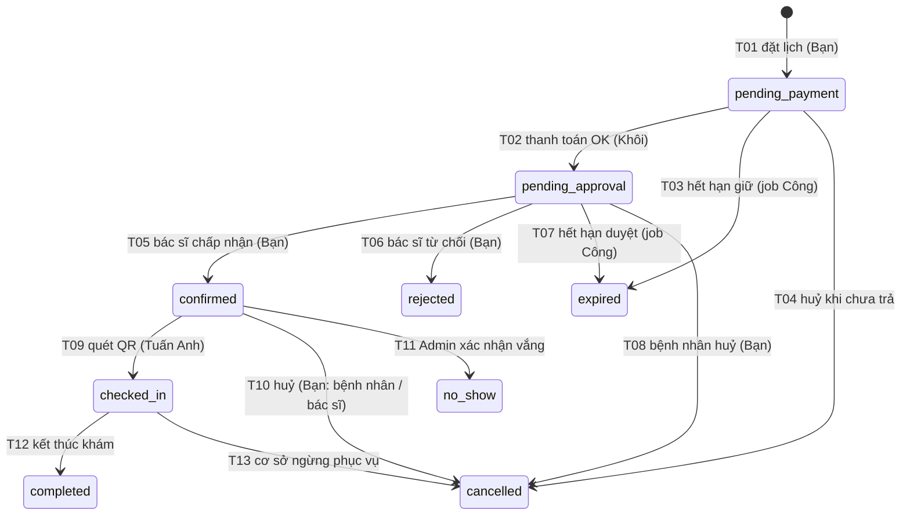

# Plan Sprint 4: Hoài Bảo, đặt lịch bác sĩ (BKD)

Ngày lập: 05/11/2026. Người thực hiện: Hoài Bảo. Miền: BKD (đặt lịch bác sĩ).

**Nguồn đã đọc** (viết tắt dùng trong file này):

| Viết tắt | Tệp | Ghi chú |
|---|---|---|
| **[PDF]** | `Sprint4Requirement.pdf` (6 trang) | Kịch bản E01–E18 (tr. 1–4), mục tiêu và ngữ cảnh chung (tr. 4), phân việc từng người (mục 4.2–4.9, tr. 4–6); phần của bạn ở **mục 4.6, tr. 5** |
| **[BL]** | `MedSi_Sprint4_Backlog.xlsx` | Sheet `Summary`, `Backlog` (51 việc), `DoD`, `E2E` |
| **[REG]** | `MedSi_CMN_Registers .xlsx` | Sheet `README`, `E2E`, `Rule_Register`, `OQ_Register`, `CF_Register`, `QC_Check`, `Traceability`, `CMP_Consolidated` |
| **[TN]** | `docs/MedSi_Tai_lieu_thong_nhat_v0.1.md` | Baseline của Sprint 4: “nguồn sự thật duy nhất”, thắng khi mâu thuẫn với tài liệu miền |
| **[SQL]** | `docs/medsi_schema_v1.sql` | Schema 14 bảng (v1.1) |
| **[S4MD]** | `docs/SPR4-requirement.md` | Bản tổng hợp tiếng Anh của E01–E18 và phân việc |
| **[CODE]** | `backend/` của repo `Main-Project-IS207` (nhánh `main`) | Chỉ dùng để biết cái gì đã có, không thay quy tắc |

> Thứ tự ưu tiên khi nguồn mâu thuẫn: [TN] (tự ghi là nguồn sự thật, mục đầu) > [SQL] > [PDF]/[BL] > [REG]. Mọi thay đổi schema, trạng thái, tham số phải qua sheet Change Requests và An duyệt ([TN] mục đầu và mục 8; [BL] sheet `DoD` dòng 10).

---

## 1. Tổng quan project

### 1.1 Mục tiêu

- MedSi là “web đặt lịch khám bệnh (Laravel 12, MySQL 8.0)” ([PDF] tr. 4, mục 4.1).
- Mục tiêu Sprint 4: **7 luồng chính chạy được từ đầu đến cuối trên máy local và gộp vào main** ([PDF] tr. 4):
  1. Đăng ký, đăng nhập, phân quyền (RBAC)
  2. Hồ sơ bệnh nhân và đồng ý dữ liệu (`patient_consents`)
  3. Danh sách có lọc và “gần tôi” (Haversine)
  4. **Đặt lịch bác sĩ và bác sĩ duyệt** ← phần của bạn
  5. Đặt lịch bệnh viện và phiếu khám (STT, QR token)
  6. Thanh toán và hoàn tiền (PaymentService, RefundService)
  7. Admin demo, lịch sử và báo cáo
- Kiểm chứng bằng **18 kịch bản E2E (E01–E18)**, trong đó 10 kịch bản P0 ([PDF] tr. 1–4; [BL] sheet `Summary` ô A19–B23, hiện cả 18 đều “Chưa chạy”).

### 1.2 Phạm vi chung và quy ước bắt buộc ([PDF] tr. 4, mục 4.1; [TN] mục 1)

- Bảng đặt tên số nhiều (`bookings`, `payments`…). Trạng thái lịch lưu chữ thường, đúng 9 giá trị: `pending_payment`, `pending_approval`, `confirmed`, `checked_in`, `completed`, `cancelled`, `expired`, `rejected`, `no_show`.
- **Mọi chuyển trạng thái lịch phải đi qua `BookingStateMachine`.**
- Tiền là VND số nguyên do server tính. Giữ chỗ 15 phút, duyệt 30 phút, phí tiện ích 20.000đ.
- CCCD, BHYT, SĐT phải che khi trả về API, trừ màn sửa của chủ hồ sơ. Không dùng dữ liệu người thật.
- Mã lỗi đặt trùng hoặc hết chỗ: **SE001**.
- Voucher chưa làm ở Sprint 4, `discount_amount` = 0.
- Ngoài phạm vi: bệnh án, đánh giá, voucher, hoa hồng, SMS, email, hoàn tiền thật ([TN] DL-19).

### 1.3 Thành phần chính

| Thành phần | Nội dung | Nguồn |
|---|---|---|
| Backend | Laravel 12, MySQL 8.0, Sanctum (`personal_access_tokens`) | [PDF] tr. 4; [CODE] |
| Frontend | Thư mục `frontend/` (React + Vite); hiện còn `lib/mockData.js` | [CODE] |
| CSDL | 14 bảng: `users`, `patient_profiles`, `patient_consents`, `specialties`, `hospitals`, `doctors`, `exam_types`, `slots`, `bookings`, `payments`, `payment_transactions`, `refunds`, `tickets`, `audit_logs` | [SQL] |
| Vai trò | `patient`, `doctor`, `staff` (bắt buộc gắn `hospital_id`), `admin`; khách không có tài khoản | [TN] DL-02; [SQL] dòng 3–8 |
| Tham số | `config/medsi.php` (bảng ở mục 5.4 dưới đây) | [TN] mục 4 |
| Máy trạng thái | T01–T16 (có T02H) | [TN] mục 3 |
| Chính sách hoàn | 14 dòng | [TN] mục 5 |

### 1.4 Hiện trạng code (quan sát [CODE], không phải yêu cầu)

- **Đã có** (phần của An): migration 14 bảng, enum trạng thái, `config/medsi.php`, model `User`/`Booking`/`Slot`, `app/Services/BookingStateMachine.php` (T01–T16), `SlotUnavailableException` (mã `SE001`), unit test chuyển trạng thái, test E13 trên MySQL.
- **Chưa có**: route nghiệp vụ (`routes/api.php` chỉ có `GET /api/health`), controller, Form Request, model `Doctor`/`PatientProfile`…, PaymentService, RefundService, job hết hạn, seeder dữ liệu mẫu. [S4MD] mục “Project Readiness” xác nhận điều này.
- Lưu ý: `BookingStateMachine::createBooking()` (T01) **đã** kiểm tra hạn đặt 2 giờ–30 ngày, giới hạn 3 lịch, giao giờ, cùng chuyên khoa cùng ngày, đồng ý dữ liệu, `request_key`, `lockForUpdate`, và **tự chèn dòng `payments`**. Nó **chưa** gán `patient_snapshot` (cột NOT NULL) và chưa gọi PaymentService hay RefundService. Bạn cần thống nhất với An và Khôi trước khi viết S4-41 (xem mục 8).

---

## 2. Phạm vi phụ trách của bạn

### 2.1 Chức năng “Đặt lịch bác sĩ” (miền BKD)

Người bệnh chọn **bác sĩ → slot 30 phút → hồ sơ**, hệ thống giữ chỗ 15 phút và chuyển sang thanh toán. Sau khi thanh toán, **bác sĩ duyệt trong 30 phút** (khác lịch bệnh viện, loại này tự `confirmed`). Sau đó có các nhánh: từ chối, hết hạn duyệt, bệnh nhân huỷ, bác sĩ nghỉ đột xuất ([PDF] mục 4.6; [TN] DL-03).

Việc được giao: **S4-32, S4-40, S4-41, S4-42, S4-43, S4-44, S4-45**. Tổng 24 điểm ≈ 48 giờ, trong đó P0 16 điểm ≈ 32 giờ ([BL] sheet `Summary`, dòng “Hoài Bảo”).
Nghiệm thu: **E01 (đến bước duyệt), E05, E07, E09, E13, E14** ([PDF] tr. 5, mục 4.6).

### 2.2 Thuộc phần của bạn

| Nhóm | Nội dung | Nguồn |
|---|---|---|
| Slot bác sĩ | API danh sách slot theo ngày kèm số chỗ còn, ẩn slot đã qua; bác sĩ tạo slot của mình (30 phút, sức chứa 1, `specialty_id` = chuyên khoa bác sĩ); không tạo trùng; admin khoá slot; chặn sửa khi có lịch đang giữ | [PDF] 4.6(a); [BL] S4-32, S4-40 |
| Tạo lịch bác sĩ | Kiểm tra 2 giờ–30 ngày, không giao giờ, không cùng chuyên khoa cùng ngày, tối đa 3 lịch còn hiệu lực mỗi hồ sơ; `lockForUpdate` dòng slot; tạo `bookings` `pending_payment` kèm `payments` (phí từ `doctors.consultation_fee`) **qua PaymentService của Khôi**; hold 15 phút; `request_key`; `patient_snapshot` **từ hàm của Hiệu** | [PDF] 4.6(b); [BL] S4-41 |
| Trang bác sĩ (phía API) | Lịch của mình; danh sách chờ duyệt có đếm ngược 30 phút; chấp nhận (T05) hoặc từ chối kèm lý do (T06); bác sĩ khác không duyệt được | [PDF] 4.6(c); [BL] S4-42 |
| Huỷ lịch | Bệnh nhân tự huỷ khi còn từ 24 giờ (ghi `cancelled_at`, `cancel_reason_code`); bác sĩ huỷ khi nghỉ đột xuất (bắt buộc lý do, slot bị ảnh hưởng sang `blocked`); cả hai tạo yêu cầu hoàn **qua RefundService** | [PDF] 4.6(d); [BL] S4-43, S4-44 |
| Tài liệu BKD | Sửa BR-BKD-02 (CF-37), BR-BKD-05 và OQ-BKD-06 (CF-43), BR-BKD-06 (CF-38), BR-BKD-17 (CF-40), BR-BKD-25, OQ-BKD-07, OQ-BKD-09 (CF-44, CF-45); BKD_SCHED đổi EX001 → SE001 (CF-13); BKD_ACT (CF-18); chốt 15 OQ; 2 buổi phỏng vấn | [PDF] tr. 5; [BL] S4-45 |

### 2.3 Không thuộc phần của bạn (chỉ gọi tới hoặc phối hợp)

| Việc | Người làm | Nguồn |
|---|---|---|
| Migration, enum, `config/medsi.php`, **BookingStateMachine**, test E13 ở mức state machine | An (S4-01, 02, 04) | [PDF] 4.2 |
| Job hết hạn giữ chỗ (T03), hết hạn duyệt (T07), đánh dấu no-show; AuditLogger AU-01..20; middleware/Policy RBAC; tạo tài khoản bác sĩ; **Admin huỷ hộ dưới 24 giờ** (E08) | Công (S4-05, 06, 10, 12, 35) | [PDF] 4.3 |
| Model/quan hệ/Factory 14 bảng; hồ sơ, đồng ý dữ liệu; **`makePatientSnapshot(profile)`** | Hiệu (S4-03, 20–24) | [PDF] 4.4 |
| Seeder (bác sĩ mẫu, slot mẫu, tài khoản mẫu); CRUD danh mục bác sĩ; demo admin duyệt thay bác sĩ (AU-17); **màn duyệt hoàn tiền** | Hoàng Huy (S4-30, 31, 33, 34) | [PDF] 4.5 |
| Slot ca bệnh viện, đặt lịch bệnh viện, **phát hành phiếu, STT, QR**, check-in (T09), lịch sử | Tuấn Anh (S4-50–54) | [PDF] 4.7 |
| **PaymentService**, cổng giả lập và callback (T02, T14, T15), **RefundService**, tiền đến muộn (T16) | Khôi (S4-60–64) | [PDF] 4.8 |
| Giao diện: luồng đặt 3 bước, đếm ngược 15 phút, **giao diện trang bác sĩ**, theo dõi hoàn tiền | Quốc Huy (S4-71, 73) | [PDF] 4.9 |
| Bước T09 (check-in) và T12 (kết thúc khám) trong E01 | Tuấn Anh / Công; E01 của bạn chỉ “đến duyệt” | [PDF] tr. 5 |

---

## 3. Đầu việc cụ thể (theo thứ tự ưu tiên)

Thứ tự dựa trên mức ưu tiên (P0 trước P1), ngày bắt đầu và phụ thuộc trong [BL] sheet `Backlog`. “Ngày” là ngày thứ mấy của sprint 7 ngày ([BL] sheet `Summary` ô A2).

| # | Mã | Ưu tiên | Điểm | Ngày bắt đầu → hạn | Việc | Kịch bản |
|---|---|---|---|---|---|---|
| 0 | — | — | — | Trước ngày 1 | Chuẩn bị: đọc [TN] mục 1–5, [SQL], code `BookingStateMachine`; chốt giao diện hàm với An, Hiệu, Khôi (xem mục 6) | — |
| 1 | **S4-40** | P0 | 3 | 2 → 2 | API slot bác sĩ: danh sách theo ngày kèm chỗ còn; bác sĩ tạo slot của mình | — |
| 2 | **S4-41** | P0 | 5 | 3 → 3 | Tạo lịch bác sĩ (T01) + payments + hold + `request_key` + snapshot | E01, E13 |
| 3 | **S4-42** | P0 | 5 | 3 → 5 | Trang bác sĩ: lịch của mình, chờ duyệt đếm ngược 30 phút, T05/T06 | E01, E05 |
| 4 | **S4-44** | P0 | 3 | 5 → 5 | Bệnh nhân tự huỷ khi còn từ 24 giờ, tạo yêu cầu hoàn | E07, E14 |
| 5 | **S4-32** | P1 | 3 | 4 → 4 | Quản lý slot: tạo, khoá, chặn sửa khi có lịch đang giữ | — |
| 6 | **S4-43** | P1 | 3 | 6 → 6 | Bác sĩ huỷ khi nghỉ đột xuất, khoá slot, hoàn 100% | E09 |
| 7 | **S4-45** | P1 | 2 | 1 → 3 (làm song song) | Tài liệu BKD + chốt 15 OQ + 2 buổi phỏng vấn | — |
| 8 | — | — | — | 6 → 7 | Chạy E01 (đến duyệt), E05, E07, E09, E13, E14; ghi kết quả vào bảng của An | Như trên |

> S4-45 là P1 nhưng [TN] mục 8 yêu cầu sửa tài liệu miền trong 3 ngày đầu, nên làm xen kẽ từ ngày 1. Nếu thiếu thời gian: cắt P2, rồi P1 (trừ tài liệu bắt buộc cho báo cáo), giữ P0 ([BL] sheet `Summary` ô A16).

### Chi tiết từng việc

**Việc 0: Chuẩn bị**
- Tạo nhánh theo quy ước `s4/<luồng>-<tên>` ([TN] mục 8), mỗi việc S4-xx một PR.
- Đọc `BookingStateMachine` để biết T01, T05, T06, T08, T10 đã kiểm tra gì; tránh viết lại.
- Hỏi An, Hiệu, Khôi: tên hàm, tham số, nơi gọi `makePatientSnapshot`, `PaymentService`, `RefundService`.

**Việc 1: S4-40, API slot bác sĩ**
- Liệt kê slot của một bác sĩ theo ngày: trả số chỗ còn (`capacity − booked_count`) và ẩn slot đã qua giờ bắt đầu (BR-BKD-21).
- Bác sĩ (role `doctor`, gắn `doctors.user_id`) tạo slot của mình: `owner_type = doctor`, `owner_id` = id bác sĩ, dài 30 phút, `capacity = 1`, `specialty_id` = `doctors.specialty_id` ([PDF] 4.6(a)).
- Không tạo trùng: unique (`owner_type`, `owner_id`, `specialty_id`, `work_date`, `start_time`) ([SQL] `uq_slot`); không giao giờ trong cùng ngày (BR-ADM-08, BR-BKD-12).
- Phụ thuộc: S4-01, S4-10 ([BL]).

**Việc 2: S4-41, tạo lịch bác sĩ**
- Form Request kiểm tra đầu vào: `doctor_id`, `slot_id`, `patient_profile_id`, `symptoms` (≤ 500, [TN] mục 4), `request_key`.
- Gọi T01 qua `BookingStateMachine` (không tự đổi trạng thái).
- Quy tắc phải thoả ([TN] DL-04, DL-06; [PDF] 4.6(b)): giờ khám cách hiện tại **2 giờ–30 ngày**; không giao giờ trên cùng hồ sơ; không cùng chuyên khoa cùng ngày; tối đa **3** lịch còn hiệu lực mỗi hồ sơ; hồ sơ có đồng ý dữ liệu (E01 dữ liệu cần có).
- `lockForUpdate` dòng slot trong transaction; hết chỗ trả **SE001** ([PDF] tr. 4).
- Tạo `payments` với `exam_fee = doctors.consultation_fee`, `service_fee = 20.000`, `discount_amount = 0` qua **PaymentService** ([PDF] 4.6(b), 4.8(a)).
- `hold_expires_at = now + 15 phút` ([TN] DL-05).
- `request_key`: cùng key và cùng nội dung thì trả kết quả cũ (BR-BKD-20; [SQL] `uq_booking_request`).
- `patient_snapshot` lấy từ `makePatientSnapshot(profile)` của Hiệu, không chứa CCCD/BHYT nguyên văn ([BL] S4-24).
- Phụ thuộc: S4-04, S4-24, S4-60 ([BL]).

**Việc 3: S4-42, trang bác sĩ (API)**
- Bác sĩ xem lịch của mình (lọc theo `bookings.doctor_id` ↔ `doctors.user_id`).
- Danh sách `pending_approval` kèm `approval_expires_at` để giao diện đếm ngược 30 phút.
- Chấp nhận → T05; từ chối (bắt buộc lý do, lưu `reject_reason`) → T06.
- Bác sĩ khác gọi phải bị từ chối (403 hoặc lỗi chuyển trạng thái) (BR-BKD-09).
- Sau T05: phiếu được phát hành đúng một lần (BR-BKD-24, phần của Tuấn Anh). Sau T06: RefundService tạo yêu cầu hoàn 100% hai phí (`policy_case` `doctor_rejected`, [TN] mục 5 dòng 5).
- Phụ thuộc: S4-10, S4-12, S4-41 ([BL]).

**Việc 4: S4-44, bệnh nhân tự huỷ**
- Cho phép khi còn **từ 24 giờ** trước giờ bắt đầu slot (BR-BKD-17; [TN] DL-07). Dưới 24 giờ thì chặn và báo liên hệ hỗ trợ (E08 bước 1).
- Lịch `confirmed` → T10; lịch `pending_approval` → T08 ([TN] mục 3).
- Ghi `cancelled_at`, `cancelled_by`, `cancel_reason_code`, `cancel_reason`.
- Tạo yêu cầu hoàn qua RefundService: **100% phí khám, 0% phí tiện ích** (dòng 1, ví dụ 200.000đ).
- Đổi lịch (E14) = huỷ lịch cũ theo chính sách này rồi đặt lịch mới; không sửa `slot_id` ([TN] DL-07; CF-32).
- Phụ thuộc: S4-04, S4-63 ([BL]).

**Việc 5: S4-32, quản lý slot**
- Admin khoá slot (`status = blocked`).
- Chặn sửa slot khi có lịch đang giữ chỗ (BR-ADM-02; BR-BKD-13); giảm sức chứa không nhỏ hơn số đã đặt (BR-BKD-22).
- Mọi cập nhật `booked_count` trong transaction có `lockForUpdate` (BR-ADM-03); `status` `full`/`available` theo `booked_count` so với `capacity` (BR-ADM-04).
- Tiêu chí: BR-ADM-02, 03, 04, 08 ([BL] S4-32). Phụ thuộc: S4-31 (Hoàng Huy).

**Việc 6: S4-43, bác sĩ nghỉ đột xuất**
- Bác sĩ huỷ lịch `confirmed` của mình, **bắt buộc lý do** → T10.
- Slot bị ảnh hưởng chuyển `blocked` ([PDF] 4.6(d); E09).
- RefundService tạo yêu cầu hoàn **100% cả hai phí** (220.000đ, dòng 3).
- Audit ghi lý do (E09).
- Phụ thuộc: S4-63 ([BL]).

**Việc 7: S4-45, tài liệu**
- Sửa các rule và OQ ở bảng 2.2 theo [TN] (ví dụ BR-BKD-02 từ “1 ngày” → “2 giờ đến 30 ngày”; BR-BKD-06 từ “10 phút” → “15 phút”).
- Đổi mã EX001–EX007 → SE001–SE007, ngày dd/MM/yyyy trong BKD_SCHED (CF-13).
- Chốt 15 OQ-BKD (hiện cả 15 đều `Open` theo [REG] sheet `QC_Check` dòng BKD).
- 2 buổi phỏng vấn có nhật ký (OQ-BKD-15; chuẩn A11).

**Việc 8: Chạy nghiệm thu**
- Chạy kịch bản và ghi kết quả vào bảng E2E của An (S4-07; [BL] sheet `DoD` dòng 7).

---

## 4. Luồng nghiệp vụ

### 4.1 Luồng chính (E01 đến bước duyệt)

Ví dụ chuẩn: phí khám 200.000đ + phí tiện ích 20.000đ = 220.000đ ([TN] mục 5).

| Bước | Người dùng thao tác | Hệ thống xử lý | Trạng thái lịch | Phần của ai |
|---|---|---|---|---|
| 1 | Bệnh nhân tìm bác sĩ, chọn ngày | Trả slot còn chỗ, ẩn slot đã qua | — | **Bạn** (S4-40); UI: Quốc Huy |
| 2 | Chọn slot, chọn hoặc tạo hồ sơ (kèm đồng ý dữ liệu) | Kiểm tra hồ sơ thuộc tài khoản và đã đồng ý | — | Hiệu (hồ sơ); UI: Quốc Huy |
| 3 | Bấm đặt lịch | **T01**: khoá slot, kiểm tra quy tắc, `booked_count` +1, tạo booking + payments `pending`, hold 15 phút, lưu snapshot | `pending_payment` | **Bạn** (S4-41) + An (state machine) + Khôi (PaymentService) + Hiệu (snapshot) |
| 4 | Thanh toán QR 220.000đ (đếm ngược 15 phút) | Cổng giả lập callback → **T02**; `payments.status = paid`; đặt hạn duyệt 30 phút | `pending_approval` | Khôi (S4-61); UI: Quốc Huy |
| 5 | Bác sĩ mở trang bác sĩ | Danh sách chờ duyệt, đếm ngược 30 phút | `pending_approval` | **Bạn** (S4-42); UI: Quốc Huy (S4-73) |
| 6 | Bác sĩ bấm chấp nhận | **T05**; phát hành phiếu `issued` + STT + QR | **`confirmed`** | **Bạn** (S4-42) + Tuấn Anh (phiếu) |

Sau bước 6 là phần tiếp của E01 (không thuộc phần “đến duyệt” của bạn): staff/Admin quét QR (**T09** → `checked_in`), bác sĩ kết thúc khám (**T12** → `completed`) ([PDF] tr. 1).

### 4.2 Các nhánh rẽ liên quan

| Nhánh | Sự kiện | Kết quả | Hoàn tiền ([TN] mục 5) | Phần của ai |
|---|---|---|---|---|
| Không thanh toán quá 15 phút (+5 phút chờ nếu giao dịch đang pending) | T03 | `expired`, `booked_count` −1 | 0 | Công (job), E03 |
| Thanh toán lỗi trong hạn | T14 | Giữ `pending_payment`, không gia hạn | 0 | Khôi, E04 |
| Bác sĩ từ chối kèm lý do | T06 | `rejected`, `booked_count` −1 | 220.000đ (`doctor_rejected`) | **Bạn**, E05 |
| Bác sĩ không duyệt quá 30 phút | T07 | `expired`, `booked_count` −1 | 220.000đ | Công (job), E06 |
| Bệnh nhân huỷ khi còn từ 24 giờ | T08 / T10 | `cancelled`, phiếu `cancelled`, −1 | 200.000đ (chỉ phí khám) | **Bạn**, E07 |
| Bệnh nhân huỷ dưới 24 giờ | Bị chặn → Admin huỷ hộ (T10) | `cancelled` | 100.000đ (50% phí khám) | Công, E08 |
| Bác sĩ nghỉ đột xuất | T10 (actor bác sĩ) | `cancelled`, slot `blocked` | 220.000đ | **Bạn**, E09 |
| Hai người cùng đặt chỗ cuối | T01 đồng thời | Một thành công, một nhận SE001 | — | **Bạn** + An, E13 |
| Đổi lịch | T10 lịch cũ + T01 lịch mới | Hai booking độc lập | Lịch cũ 200.000đ; lịch mới trả 220.000đ | **Bạn** + Quốc Huy, E14 |
| Quá giờ bắt đầu slot 15 phút, chưa check-in | T11 (Admin xác nhận) | `no_show`, phiếu `expired` | 0 | Công / Hoàng Huy, E12 |

### 4.3 Sơ đồ trạng thái (lịch bác sĩ)

Nguồn: [TN] mục 3.

### 4.4 Điểm tích hợp

| Điểm | Bạn gọi / bị gọi | Người phụ trách | Nguồn |
|---|---|---|---|
| `BookingStateMachine::apply(booking, event, actor, context)` | Bạn gọi cho T01, T05, T06, T08, T10 | An | [PDF] 4.2; [CODE] |
| `makePatientSnapshot(profile)` | Bạn gọi khi T01 | Hiệu | [PDF] 4.4(f); [BL] S4-24 |
| `PaymentService` (tạo `payments`) | Bạn gọi khi T01 | Khôi | [PDF] 4.6(b), 4.8(a) |
| Callback cổng → T02 | Khôi gọi, đặt lịch bác sĩ sang `pending_approval` | Khôi | [PDF] 4.8(b) |
| `RefundService` (tạo `refunds` `requested`) | Bạn gọi sau T06, T08, T10 | Khôi | [PDF] 4.6(d), 4.8(c) |
| Phát hành phiếu sau T05 | Sự kiện từ lịch → phiếu, đúng một lần (BR-BKD-24) | Tuấn Anh | [PDF] 4.7(c); [REG] Rule_Register |
| Job T03/T07 | Job gọi state machine trên lịch của bạn | Công | [PDF] 4.3(a) |
| Middleware/Policy role `doctor`, `patient`, `admin` | Bạn dùng để bảo vệ route | Công | [PDF] 4.3(c) |
| AuditLogger (AU-xx) | Bạn ghi sự kiện | Công (danh mục AU) | [PDF] 4.3(b) |
| Admin demo duyệt thay bác sĩ (AU-17) | Gọi T05 với actor admin | Hoàng Huy | [PDF] 4.5(c) |
| Màn duyệt hoàn tiền | Duyệt các yêu cầu bạn tạo | Hoàng Huy | [PDF] 4.5(d) |
| Giao diện đặt lịch, trang bác sĩ | Gọi API của bạn | Quốc Huy | [PDF] 4.9 |

---

## 5. Dữ liệu và API liên quan

### 5.1 Bảng và cột chính ([SQL])

**`slots`**

| Cột | Kiểu / ràng buộc | Dùng cho |
|---|---|---|
| `owner_type`, `owner_id` | ENUM(`doctor`,`hospital`) + id; không FK cứng | Lịch bác sĩ: `owner_type = doctor` |
| `specialty_id` | FK `specialties` | Bằng `doctors.specialty_id` |
| `work_date`, `start_time`, `end_time` | DATE, TIME (giờ địa phương Asia/Ho_Chi_Minh, DL-24) | Slot 30 phút |
| `capacity`, `booked_count` | `capacity ≥ 1`, `booked_count ≤ capacity` (CHECK) | Sức chứa 1 với bác sĩ |
| `status` | ENUM(`available`,`full`,`blocked`) | Khoá slot, hết chỗ |
| UNIQUE `uq_slot` | (`owner_type`,`owner_id`,`specialty_id`,`work_date`,`start_time`) | Không trùng slot |

**`bookings`**

| Cột | Ghi chú |
|---|---|
| `code` | UNIQUE |
| `user_id`, `patient_profile_id` | Người đặt, hồ sơ đi khám |
| `booking_type` | `doctor` → bắt buộc `doctor_id`, `hospital_id` và `exam_type_id` = NULL (CHECK `ck_booking_type`) |
| `doctor_id`, `slot_id` | FK |
| `symptoms` | VARCHAR(500) |
| `patient_snapshot` | JSON **NOT NULL**, đã che |
| `status` | 9 giá trị |
| `hold_expires_at` | T01 + 15 phút |
| `approval_expires_at` | T02 + 30 phút |
| `decided_by`, `decided_at`, `reject_reason` | T05/T06 |
| `cancelled_at`, `cancelled_by`, `cancel_reason_code`, `cancel_reason` | T08/T10 |
| `request_key` | UNIQUE (`user_id`,`request_key`) |
| `version` | Tăng mỗi lần chuyển |

**`payments`**: `booking_id` (UNIQUE, một lịch một payment), `method` (cho phép NULL), `exam_fee`, `discount_amount` (= 0), `service_fee`, `total_amount` (CHECK = phí khám − giảm + tiện ích), `received_amount`, `refunded_amount` (≤ `received_amount`), `status` (`pending`,`paid`,`failed`,`cancelled`,`expired`,`refunded`).

**`refunds`**: `payment_id`, `booking_id`, `amount` = `exam_fee_refunded` + `service_fee_refunded` (CHECK), `policy_case`, `reason`, `status` (6 giá trị), `refund_ref` (UNIQUE), `requested_by` (NULL = hệ thống).

**Bảng đọc**: `doctors` (`user_id` UNIQUE, `specialty_id`, `hospital_id` có thể NULL, `consultation_fee` DECIMAL(12,0), `deleted_at`); `patient_profiles`; `patient_consents` (`is_agreed`, `revoked_at`); `users` (`role`); `tickets` (để biết phiếu); `audit_logs` (chỉ thêm).

### 5.2 Rule BKD cần tuân thủ ([REG] sheet `Rule_Register`, chủ sở hữu Hoài Bảo)

| Rule | Nội dung (tóm tắt) | Áp vào việc |
|---|---|---|
| BR-BKD-01 | Chỉ nhận hồ sơ được phép dùng và bác sĩ, slot đang công bố | S4-41 |
| BR-BKD-02 | Hạn đặt (**sửa thành 2 giờ–30 ngày**, CF-37) | S4-41, S4-45 |
| BR-BKD-03, 04 | Không vượt sức chứa; tranh chỗ cuối chỉ một thắng | S4-41, E13 |
| BR-BKD-05 | Không giao giờ trên cùng hồ sơ (CF-43) | S4-41 |
| BR-BKD-06 | Hạn giữ chỗ (**sửa thành 15 phút**, CF-38) | S4-41, S4-45 |
| BR-BKD-09, 10 | Bác sĩ chỉ duyệt lịch của mình, còn hạn; từ chối phải có lý do | S4-42 |
| BR-BKD-12, 13, 22 | Không ca giao nhau; chặn sửa khi ảnh hưởng lịch; không giảm sức chứa dưới số đã đặt | S4-40, S4-32 |
| BR-BKD-17 | Tự huỷ phải còn ít nhất 24 giờ (CF-40) | S4-44 |
| BR-BKD-20 | Trùng `request_key` cùng nội dung thì trả kết quả cũ | S4-41 |
| BR-BKD-21 | Slot đã qua hoặc bị đóng thì không cho đặt | S4-40, S4-41 |
| BR-BKD-23 | Đổi lịch = huỷ cũ + đặt mới | S4-44, E14 |
| BR-BKD-24 | Xác nhận xong thì gửi sự kiện cho TKT phát hành phiếu đúng một lần | S4-42 |

Rule ADM dùng cho S4-32: BR-ADM-02 (sửa/huỷ slot kiểm tra `booked_count`), BR-ADM-03 (`lockForUpdate`), BR-ADM-04 (tự động `full`/`available`), BR-ADM-08 (không giao giờ cùng `work_date`).

### 5.3 Endpoint

**Đường dẫn endpoint: Chưa có thông tin trong tài liệu.** `routes/api.php` hiện chỉ có `GET /api/health` ([CODE]). Tài liệu chỉ nêu chức năng cần có; bạn phải thống nhất đường dẫn và định dạng JSON với Quốc Huy (người nối giao diện).

| Chức năng API cần có | Vai trò gọi | Việc | Nguồn |
|---|---|---|---|
| Danh sách slot bác sĩ theo ngày (kèm chỗ còn, ẩn slot đã qua) | Khách, bệnh nhân | S4-40 | [PDF] 4.6(a) |
| Bác sĩ tạo slot của mình | `doctor` | S4-40 | [PDF] 4.6(a) |
| Admin khoá slot; sửa slot (bị chặn khi có lịch đang giữ) | `admin` | S4-32 | [PDF] 4.6(a) |
| Tạo lịch bác sĩ | `patient` (và `admin`, theo T01 của [TN]) | S4-41 | [PDF] 4.6(b) |
| Lịch của bác sĩ; danh sách chờ duyệt có hạn duyệt | `doctor` | S4-42 | [PDF] 4.6(c) |
| Chấp nhận lịch (T05) / từ chối kèm lý do (T06) | `doctor` (Admin trong demo) | S4-42 | [PDF] 4.6(c) |
| Bệnh nhân huỷ lịch (kèm mã lý do) | `patient` | S4-44 | [PDF] 4.6(d) |
| Bác sĩ huỷ do nghỉ đột xuất (kèm lý do) | `doctor` | S4-43 | [PDF] 4.6(d) |

Mã lỗi đã biết: **SE001** (hết chỗ hoặc đặt trùng; `App\Exceptions\Booking\SlotUnavailableException`). Mã các lỗi khác (ngoài hạn đặt, quá 3 lịch, dưới 24 giờ…): theo BKD_SCHED đổi sang SE001–SE007 (CF-13), nhưng **nội dung từng mã chưa có thông tin trong tài liệu** được đính kèm.

### 5.4 Tham số dùng (`config/medsi.php`, [TN] mục 4)

| Khoá | Giá trị | Dùng ở |
|---|---|---|
| `hold_minutes` | 15 | S4-41 |
| `grace_minutes` | 5 | Job T03 (Công) |
| `approval_minutes` | 30 | S4-42 |
| `min_lead_doctor_minutes` | 120 | S4-41 |
| `max_advance_days` | 30 | S4-41 |
| `free_cancel_hours` | 24 | S4-44 |
| `max_active_bookings_per_profile` | 3 | S4-41 |
| `service_fee_amount` | 20000 | PaymentService |
| `symptoms_max_length` | 500 | S4-41 |
| `no_show_doctor_after_start_minutes` | 15 | E12 (không phải của bạn) |

Không viết cứng các số này trong code ([BL] sheet `DoD` dòng 3).

### 5.5 Tài liệu tham chiếu

- [TN] mục 1 (DL-03, 04, 05, 06, 07, 09, 12, 18, 21), mục 3 (bảng T01–T16), mục 5 (chính sách hoàn), mục 6 (công thức tiền), mục 7 (RBAC dòng 20, 21, 23).
- [REG] sheet `Rule_Register` (BR-BKD-01..25), `OQ_Register` (OQ-BKD-01..15), `CF_Register` (CF-13, 16, 18, 21, 37–45, 48), `CMP_Consolidated` (12 tiêu chí BKD có liên kết nguồn).
- Tài liệu miền BKD_SCHED, BKD_ACT, BKD_STM: **[PDF] mục 4.6 yêu cầu đính kèm “BKD_SCHED hiện tại” nhưng tệp này không có trong bộ tài liệu được gửi.**

---

## 6. Phụ thuộc và người liên quan

### 6.1 Việc phải chờ ([BL] cột “Phụ thuộc”)

| Việc của bạn | Chờ việc | Của ai | Hạn của việc đó |
|---|---|---|---|
| S4-40 | S4-01 (migration), S4-10 (middleware/Policy) | An, Công | Ngày 1, ngày 2 |
| S4-41 | S4-04 (BookingStateMachine), S4-24 (`makePatientSnapshot`), S4-60 (PaymentService) | An, Hiệu, Khôi | Ngày 3, ngày 2, ngày 2 |
| S4-42 | S4-10, S4-12 (tài khoản bác sĩ), S4-41 | Công, Công, bạn | Ngày 2, ngày 3, ngày 3 |
| S4-32 | S4-31 (CRUD danh mục) | Hoàng Huy | Ngày 4 |
| S4-43 | S4-63 (RefundService) | Khôi | Ngày 5 |
| S4-44 | S4-04, S4-63 | An, Khôi | Ngày 3, ngày 5 |

### 6.2 Người khác chờ bạn

| Việc của người khác | Chờ việc của bạn | Nguồn |
|---|---|---|
| S4-33 demo admin (Hoàng Huy) | S4-41 | [BL] |
| S4-71 luồng đặt 3 bước (Quốc Huy) | S4-41 | [BL] |
| S4-73 trang bác sĩ, giao diện (Quốc Huy) | S4-42 | [BL] |
| E13 (An kiểm thử) | S4-41 | [BL] sheet `E2E` |
| E14 (Quốc Huy kiểm thử) | S4-44 | [BL] sheet `E2E` |

### 6.3 Người phối hợp

| Người | Phối hợp về |
|---|---|
| **An** | Cách gọi `BookingStateMachine` (T01, T05, T06, T08, T10); review và gộp PR vào `develop`; duyệt Change Request; bảng kết quả E2E |
| **Hiệu** | Chữ ký và đầu ra của `makePatientSnapshot(profile)`; model `Doctor`, `PatientProfile` |
| **Khôi** | Giao diện PaymentService (tạo payments) và RefundService (tạo yêu cầu hoàn, `policy_case`); callback T02 cho lịch bác sĩ |
| **Công** | Middleware/Policy cho `doctor`/`patient`/`admin`; danh mục AU; job T03/T07 đụng tới lịch của bạn |
| **Tuấn Anh** | Phát hành phiếu sau T05 (BR-BKD-24); phiếu `cancelled` khi T10; CF-37, 43, 44, 45, 59 chung giữa BKD và BKH |
| **Hoàng Huy** | Seeder: bác sĩ mẫu có `user_id`, slot còn chỗ / còn 1 chỗ / đầy / bị khoá / đã qua; CRUD bác sĩ; màn duyệt hoàn |
| **Quốc Huy** | Hợp đồng API (đường dẫn, JSON, mã lỗi) cho luồng đặt và trang bác sĩ; E14 |

---

## 7. Tiêu chí hoàn thành

### 7.1 Theo từng việc ([BL] cột “Tiêu chí nghiệm thu”, [PDF] mục 4.6)

| Việc | Xong khi |
|---|---|
| S4-40 | Không tạo được slot trùng; slot đã qua không xuất hiện trong danh sách; slot bác sĩ tạo ra có 30 phút, `capacity = 1`, đúng `specialty_id` |
| S4-41 | Chạy được đến bước thanh toán (lịch `pending_payment`, `payments` `pending`, `total_amount = 220.000` với phí khám 200.000); hai người cùng đặt chỗ cuối chỉ một thành công, người kia nhận **SE001**, `booked_count = capacity` (E13); gửi lại cùng `request_key` không tạo lịch mới |
| S4-42 | Bác sĩ khác không duyệt được; lịch chuyển đúng T05 (`confirmed`) hoặc T06 (`rejected`, có `reject_reason`); E05: `booked_count` −1, yêu cầu hoàn 220.000đ `policy_case` `doctor_rejected` |
| S4-44 | E07: lịch và phiếu `cancelled`, `booked_count` −1, hoàn 200.000đ phí khám và 0đ phí tiện ích, `payments.status` vẫn `paid`; dưới 24 giờ bị chặn; E14 tạo được hai booking độc lập |
| S4-32 | Đạt BR-ADM-02, 03, 04, 08: admin khoá được slot; sửa slot đang có lịch giữ bị chặn |
| S4-43 | E09: lịch và phiếu `cancelled`, slot `blocked`, hoàn 220.000đ, audit có lý do |
| S4-45 | 15 OQ-BKD không còn `Open`; có 2 nhật ký phỏng vấn; BR-BKD-02, 05, 06, 17, 25 và các OQ liên quan khớp [TN]; BKD_SCHED dùng SE001 |

### 7.2 Định nghĩa hoàn thành chung ([BL] sheet `DoD`)

- [ ] Chạy được trên `develop` sau khi gộp; không phá `migrate:fresh --seed`.
- [ ] Không có chuỗi trạng thái viết cứng; dùng enum chung và `config/medsi.php`.
- [ ] Mọi chuyển trạng thái lịch đi qua `BookingStateMachine`; mọi thay đổi `booked_count` nằm trong transaction có `lockForUpdate`.
- [ ] CCCD, BHYT, SĐT được che trong API; `audit_logs` không chứa dữ liệu nhạy cảm nguyên văn.
- [ ] Có ít nhất một test cho đường chính và một test cho luồng ngoại lệ.
- [ ] Kịch bản E2E liên quan chạy được; ghi kết quả vào bảng của An.
- [ ] Một PR cho một việc; mô tả có mã S4-xx, kịch bản E2E đã kiểm tra, ảnh chụp hoặc kết quả test; có ít nhất một người review; An gộp.
- [ ] Đổi schema, trạng thái, tham số phải có dòng Change Request và An duyệt trước.
- [ ] Tài liệu dùng đúng mã chuẩn (BR-BKD-nn, OQ-BKD-nn, UC-BKD-nn) và đúng 9 tên trạng thái.
- [ ] E13 kiểm thử trên MySQL/InnoDB với kết nối riêng, không dùng SQLite ([S4MD] “Cross-Team Gates”).
- [ ] Nghiệm thu E2E bằng API và CSDL thật; dữ liệu mock hoặc LocalStorage không tính ([S4MD] “Cross-Team Gates”).

---

## 8. Điểm chưa rõ (cần hỏi lại)

### 8.1 Mâu thuẫn giữa các tài liệu

| # | Mâu thuẫn | Nguồn | Hỏi ai |
|---|---|---|---|
| 1 | **Mã lỗi E13**: [PDF] tr. 3 và [TN] DL-21 ghi **SE001**; sheet `E2E` của [BL] và [REG] ghi **EX-BKD-01** | [PDF], [BL], [REG] | An |
| 2 | **Người check-in trong E01**: [PDF] và [TN] DL-02 ghi `staff` gắn `hospital_id` hoặc Admin, không có Kiosk; [BL] sheet `E2E` (E01 bước 4), [BL] S4-53, [REG] CF-25 và CF-45 vẫn ghi “Kiosk” | [PDF], [TN], [BL], [REG] | An, Tuấn Anh |
| 3 | **Vai trò**: [REG] CF-46 đề xuất chỉ `patient`, `doctor`, `admin` (staff để sau); [TN] DL-02 và [SQL] có `staff` | [REG], [TN] | An, Công |
| 4 | **Trạng thái CF**: [TN] ghi đã chốt toàn bộ 59 CF; [REG] sheet `CF_Register` vẫn để phần lớn là “Đề xuất” | [TN], [REG] | An |
| 5 | **Hạn giữ chỗ**: BR-BKD-06, OQ-BKD-02, OQ-UI-01 ghi 10 phút; [TN] DL-05 và [PDF] ghi 15 phút | [REG], [TN] | Theo [TN] (15); bạn sửa tài liệu (S4-45) |
| 6 | **Hạn đặt tối thiểu**: BR-BKD-02 ghi 1 ngày; [TN] DL-04 ghi 2 giờ cho lịch bác sĩ | [REG], [TN] | Theo [TN]; bạn sửa tài liệu |
| 7 | **Giới hạn 3 lịch**: OQ-BKD-06 ghi “chưa đưa thành điều kiện chặn”; [TN] DL-06 và [PDF] 4.6(b) yêu cầu chặn | [REG], [TN] | Theo [TN]; xác nhận lại với An |
| 8 | **Ai ghi `checked_in`/`completed`**: OQ-BKD-07 ghi Admin; [TN] DL-09 ghi staff/Admin quét QR, bác sĩ hoặc Admin ghi `completed` | [REG], [TN] | Theo [TN] |
| 9 | **Số lần AU-11 trong E01**: [BL]/[REG] ghi “AU-11 (5 lần)”; [PDF] không ghi số lần | [BL], [PDF] | Công |
| 10 | **Việc tài liệu S4-45**: [PDF] liệt kê thêm BR-BKD-05, OQ-BKD-06, OQ-BKD-07, OQ-BKD-09, BKD_ACT; [BL] chỉ ghi BR-BKD-02, 06, 17, 25 và OQ | [PDF], [BL] | An |
| 11 | **Tên phiên bản baseline**: [PDF] tr. 4 nhắc “Tài liệu thống nhất v1.0”; repo chỉ có v0.1. [BL] S4-02 nhắc “tham số mục 14”, còn v0.1 để tham số ở mục 4 | [PDF], [BL], [TN] | An |
| 12 | **Người kiểm thử và nghiệm thu**: [PDF] mục 4.6 giao bạn nghiệm thu E13, E14, nhưng bảng kịch bản ghi người kiểm thử E13 là An, E14 là Quốc Huy | [PDF], [BL] | An |

### 8.2 Thông tin còn thiếu

| # | Câu hỏi | Ghi chú |
|---|---|---|
| 13 | **Đường dẫn và định dạng API** cho slot, đặt lịch, duyệt, huỷ | Chưa có thông tin trong tài liệu |
| 14 | **Danh mục `cancel_reason_code`** (E07 “bệnh nhân chọn lý do”) | Chưa có thông tin trong tài liệu |
| 15 | **Nội dung SE002–SE007** (hạn đặt, quá 3 lịch, dưới 24 giờ…) | BKD_SCHED không có trong bộ tài liệu được gửi |
| 16 | **Danh mục AU-01..AU-20** (AU-10, 11, 12, 14 nghĩa là gì, ai ghi) | [S4MD] “Cross-Team Gates” nói phải công bố trước khi kiểm; Công phụ trách |
| 17 | **Giao diện PaymentService và RefundService** (tên hàm, tham số, `policy_case` cho từng tình huống) | Chưa có thông tin trong tài liệu. Ngoài ra code T01 hiện tự chèn `payments`, trùng vai trò với PaymentService. Cần An và Khôi chốt chỗ gọi |
| 18 | **Ai gọi RefundService**: `BookingStateMachine` hay service của bạn sau khi chuyển trạng thái? | [TN] DL-12 chỉ ghi “hệ thống tự tạo” |
| 19 | **Ai tạo slot cho bác sĩ**: bác sĩ tự tạo ([PDF] 4.6(a)) hay Admin (BR-ADM, UC-ADM-03)? Có sinh slot từ lịch tuần và ngoại lệ ngày không (BR-BKD-14)? | Schema không có bảng lịch tuần hay ngoại lệ ngày |
| 20 | **“Chặn sửa khi có lịch đang giữ”**: “đang giữ” chỉ là `pending_payment` hay mọi lịch còn hiệu lực? Được sửa những trường nào? | Chưa có thông tin trong tài liệu |
| 21 | **Admin khoá slot đã có lịch** thì xử lý lịch đó ra sao? | OQ-BKD-13 còn Open |
| 22 | **Bác sĩ nghỉ đột xuất**: chỉ khoá slot của lịch bị huỷ hay mọi slot trong khoảng nghỉ? Có hạn chót huỷ không? | [S4MD] ghi “chỉ khoá slot bị ảnh hưởng”; phần còn lại chưa có thông tin |
| 23 | **Định nghĩa “lịch còn hiệu lực”** khi đếm tối đa 3 lịch: có tính `checked_in` không? | Code đang tính `checked_in`; tài liệu chưa định nghĩa |
| 24 | **Check-in lịch bác sĩ**: lịch bác sĩ có `hospital_id = NULL` và `doctors.hospital_id` có thể NULL, vậy staff nào được quét? | Chưa có thông tin trong tài liệu |
| 25 | **Bệnh nhân huỷ khi đang `pending_payment` (T04)** có thuộc phần bạn không? | [TN] mục 3 có T04 nhưng không có việc S4 nào ghi rõ |
| 26 | **“Trang bác sĩ” S4-42**: chỉ backend API hay cả giao diện? | Quốc Huy có S4-73 “trang bác sĩ” (giao diện) |
| 27 | **Lịch sprint**: [BL] ghi bắt đầu thứ Hai 26/10/2026; [S4MD] ghi ngày cũ đã qua, nhóm phải đặt ngày mới | Hỏi An lịch mới |
| 28 | **Thời gian di chuyển** khi bác sĩ làm nhiều cơ sở | OQ-BKD-04: “chưa chốt” |
| 29 | **Mẫu nhật ký phỏng vấn** và đối tượng phỏng vấn | [BL] S4-14 nhắc nhật ký 1 trang; chưa có mẫu cho BKD |

### 8.3 Ghi chú về môi trường làm việc (quan sát, không phải yêu cầu)

- Trong `C:\webiss` có hai repo: repo gốc `Mini-Project-IS207` (nhánh `feature/doctor-appointment`, phần lớn file backend đang ở trạng thái “deleted” trong working tree) và repo `Main-Project-IS207` (nhánh `main`, chứa `docs/` và code baseline mới). Kế hoạch này dựa trên **`Main-Project-IS207`**. Code đặt lịch cũ trên nhánh `feature/doctor-appointment` theo schema cũ, nên cần kiểm tra lại trước khi dùng.
