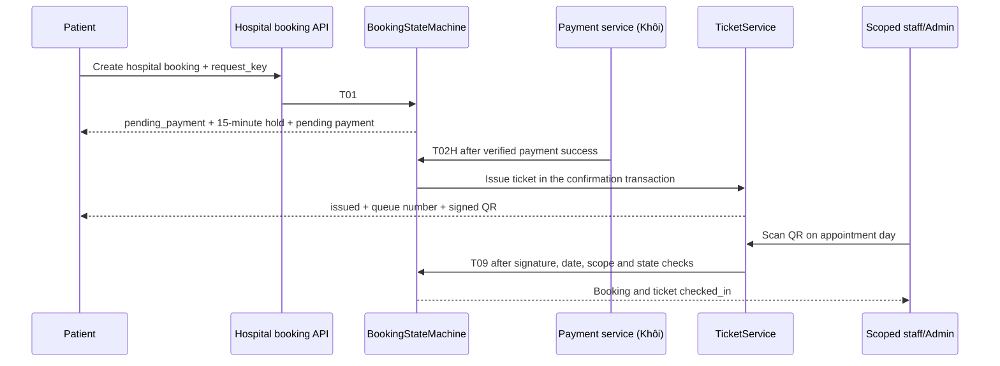
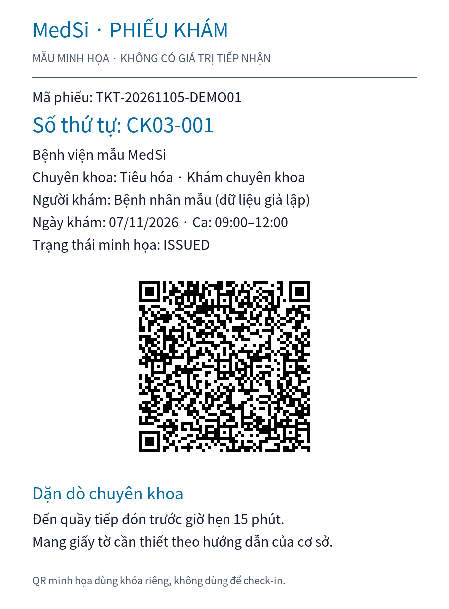

# BKH/TKT — Đặt khám bệnh viện và phiếu khám (Sprint 4)

Chủ sở hữu: Tuấn Anh. Phạm vi: S4-50–55. Cập nhật: 05/11/2026.

## 1. Nguồn và cách giải quyết khác biệt

- `MedSi_Sprint4_Backlog.xlsx`, sheet `Backlog`, hàng 36–41: mã việc, sản phẩm bàn giao và phụ thuộc; sheet `E2E`, E01/E02: luồng nghiệm thu.
- `MedSi_CMN_Registers .xlsx`, `Rule_Register!A66:L91`: BR-BKH/BR-TKT; `OQ_Register!A33:I38`: câu hỏi mở; `CF_Register`: quyết định đề xuất.
- [Baseline đang áp dụng](MedSi_Tai_lieu_thong_nhat_v0.1.md), [schema v1.1](medsi_schema_v1.sql), [yêu cầu E2E đã hợp nhất](SPR4-requirement.md).

Các file gốc được cung cấp từ Downloads; không sửa hoặc ghi đè workbook.
Baseline bản tải xuống còn ghi Kiosk và để vai trò nhân viên sang sau. Bản trong repo và
SPR4-requirement đã chốt `staff` gắn `hospital_id` hoặc Admin, không có tài khoản Kiosk.
Implementation giữ quyết định đó. Quy tắc cũ “hết ca tự no-show/expired”, giới hạn theo
tài khoản, hoặc khóa 30 ngày sau ba lần vắng không được dùng thay baseline.

## 2. Bàn giao theo backlog

| Mã | Nội dung chính thức | Bàn giao |
|---|---|---|
| S4-50 | Slot cấp ca, sức chứa riêng theo chuyên khoa | API ca còn chỗ; Admin tạo ca; kiểm thử hai chuyên khoa cùng ca |
| S4-51 | Viện → khoa → loại khám → ca → hồ sơ; hold; T02H | API đặt lịch, giao diện chọn khám, kết nối state machine và payment handoff |
| S4-52 | Ticket code, JWT HS256, queue scope/sequence, dặn dò | TicketService dùng chung cho T02H/T05; PNG QR; kiểm thử phát hành đồng thời |
| S4-53 | Xác thực QR/ngày/trạng thái, check-in | API và màn hình staff/Admin; quét lại báo đã tiếp nhận, không thay đổi dữ liệu |
| S4-54 | Ba tab lịch sử, tìm mã phiếu, xem QR, tải PNG hoặc PDF | Lịch sử theo user; chi tiết phiếu; tải toàn bộ phiếu PNG và in trình duyệt |
| S4-55 | BKH_DD, rule sửa, ngoại lệ tham chiếu TKT, mẫu phiếu, nguồn so sánh, hai phỏng vấn | Tài liệu này và ảnh mẫu; hai phỏng vấn còn chờ thực hiện, không có bằng chứng phỏng vấn giả |

## 3. Từ điển dữ liệu vật lý

Không dùng `shift_session`, `max_shift_capacity`, bảng đơn đặt khám riêng, hay trạng thái “đang khám”.

| Bảng | Cột và ý nghĩa BKH/TKT |
|---|---|
| `slots` | `owner_type=hospital`, `owner_id=hospital_id`, `specialty_id`, `work_date`, `start_time`, `end_time`; `capacity` là sức chứa ca của chuyên khoa; `booked_count` là số chỗ đã giữ; `status=available/full/blocked` |
| `bookings` | `booking_type=hospital`, `hospital_id`, `exam_type_id`, `slot_id`, `patient_profile_id`, `user_id`; `doctor_id=null`; `patient_snapshot` do server che thông tin; `request_key` chống tạo lặp; `hold_expires_at`; `status`, `version` |
| `payments` | Một payment mỗi booking; `exam_fee`, `discount_amount=0`, `service_fee=20000`, `total_amount`, `received_amount`, `refunded_amount`, `status`; tất cả số tiền là VND nguyên, không dùng float |
| `tickets` | Một ticket mỗi booking; `ticket_code=TKT-YYYYMMDD-XXXXXX`, `qr_token` tối đa 512 ký tự, `queue_scope`, `queue_seq`, `queue_number`, `room_number` tùy chọn, `instructions`, `status`, `check_in_at` |

Queue scope là `owner_type:owner_id:specialty_id:work_date`. Ví dụ số hiển thị `CK03-001`.
Số được cấp lúc phát hành, tăng qua các ca cùng scope, không tái sử dụng sau hủy và
bắt đầu lại ở 001 cho ngày khám mới. Hai cơ sở/chuyên khoa có bộ đếm độc lập.

## 4. Quy tắc đã chuẩn hóa

| Rule | Nội dung hiện hành |
|---|---|
| BR-BKH-01 | Đặt khám bệnh viện trước ca từ 1 đến 30 ngày, theo config và múi giờ Asia/Ho_Chi_Minh. |
| BR-BKH-02/03/04 | Giữ một chỗ trong transaction với khóa slot; hold 15 phút. Job hết hạn và grace 5 phút thuộc S4-05. |
| BR-BKH-05 | Mỗi hồ sơ có tối đa ba lịch còn hiệu lực, tính cả chờ thanh toán, chờ duyệt, xác nhận và đã tiếp nhận. |
| BR-BKH-06 | Một hồ sơ không đặt trùng giờ hoặc cùng chuyên khoa trong một ngày. |
| BR-BKH-07/13/14 | Thanh toán hợp lệ gọi T02H, tự xác nhận và cấp phiếu; không chọn bác sĩ; server tính phí khám cộng 20.000đ tiện ích. |
| BR-BKH-08/09/10 | Hủy/hoàn dùng state machine và dịch vụ PAY chung; không tạo logic tiền hoặc endpoint hoàn riêng trong BKH. |
| BR-BKH-11 | API lịch sử luôn lọc user đăng nhập. Bệnh nhân khác không được đọc hoặc tải phiếu. |
| BR-BKH-12 | Sau ca bệnh viện 120 phút, job đánh dấu đủ điều kiện; Admin xác nhận no-show, phiếu expired, không hoàn tiền. |
| BR-TKT-01/02/03 | T02H/T05 phát hành một phiếu duy nhất, mã khó đoán, JWT ký HS256 có mã phiếu và thời điểm tạo. |
| BR-TKT-04/05/06 | Cấp số nguyên tử theo owner/khoa/ngày; giữ số đã cấp khi hủy; kiểm tra trạng thái DB khiến QR bị hủy không thể tiếp nhận. |
| BR-TKT-07/08/09 | Staff đúng bệnh viện hoặc Admin tiếp nhận đúng ngày; quét lại báo đã check-in, không đổi version, thời điểm, số hoặc audit. |
| BR-TKT-10/12 | Phiếu theo T11/T12/T13, không tự expired ngay khi hết ca. Lịch bệnh viện thật dừng ở checked_in. |
| BR-TKT-11 | Chụp dặn dò chuyên khoa vào phiếu lúc phát hành để xem lại/in/tải. |

HMAC là chữ ký, không mã hóa payload. QR chỉ chứa mã phiếu, issuer, audience, `iat`, `exp`,
không chứa hồ sơ, số điện thoại hay CCCD. Token hết hiệu lực sau ngày khám; check-in vẫn
kiểm tra ngày và trạng thái hiện tại trong DB. Secret lấy từ `MEDSI_QR_SECRET` (ít nhất
32 byte) hoặc khóa dẫn xuất có ngữ cảnh riêng từ `APP_KEY`. Không ghi token vào audit/log.

## 5. API và giao diện

Các URL dưới đây có prefix `/api`. API riêng tư cần Sanctum Bearer token của tài khoản `active`.

| Method, URL | Quyền | Nội dung |
|---|---|---|
| GET `/hospitals` | Public | Danh sách cơ sở còn hoạt động |
| GET `/hospitals/{id}/slots?specialty_id=&date=` | Public | Ca còn chỗ trong cửa sổ đặt; `remaining_capacity` |
| GET `/hospitals/{id}/booking-options` | Đăng nhập | Loại khám, khoa, hồ sơ của user có consent, phí tiện ích |
| POST `/hospitals/{id}/slots` | Admin | Tạo ca, sức chứa riêng theo khoa; không trùng ca |
| POST `/hospital-bookings` | Patient | `hospital_id`, `specialty_id`, `exam_type_id`, `slot_id`, `patient_profile_id`, `request_key`, `symptoms?` |
| GET `/me/bookings?tab=upcoming/completed/closed&q=&page=&per_page=` | Patient/Admin | Lịch của chính user; tìm mã phiếu/mã lịch/cơ sở/bác sĩ; phân trang |
| GET `/bookings` | Patient/Admin | Alias lịch sử để tương thích API cũ |
| GET `/bookings/{id}/ticket` | Patient sở hữu/Admin | Booking đã che thông tin và ticket, JWT, `qr_png_data_uri`; không cache |
| GET `/bookings/{id}/ticket/qr.png` | Patient sở hữu/Admin | Tải riêng QR PNG; không cache |
| POST `/tickets/check-in` | Staff đúng cơ sở/Admin | Body `qr_token`; tiếp nhận một lần, response không trả token |

Trả `201` khi tạo booking, `200` khi lặp đúng request key; dùng lại key với payload khác
bị từ chối. `409/SE001` khi ca bị chặn hoặc hết chỗ. Dữ liệu không hợp lệ trả `422`;
chưa xác thực `401`; sai quyền `403`; đọc phiếu người khác `404`.

Ngoại lệ check-in chỉ định nghĩa trong TKT; BKH tham chiếu:

- `EX-TKT-01` (`422`): QR sai chữ ký, không đúng token đã cấp, không tồn tại hoặc hết hạn.
- `EX-TKT-02` (`422`): sai ngày hoặc booking/ticket không cho tiếp nhận; (`409`): đã check-in.

Màn hình: `/hospital-booking`, `/hospitals/{id}/book`, `/my-bookings`,
`/bookings/{id}/ticket`, `/check-in`. Dùng dữ liệu API, không fallback LocalStorage.
Các tab hồ sơ/tài khoản cũ vẫn giữ tại `/my-bookings?tab=profiles` và `?tab=account`.
Phiếu PNG tải từ màn hình chứa mã phiếu, trạng thái, số, cơ sở, người khám, ca, QR và dặn dò.

## 6. Tích hợp với phần việc khác



- Khôi: kiểm tra/idempotency giao dịch trong dịch vụ PAY; sau khi payment thành `paid`,
  gọi `BookingStateMachine::apply($booking, BookingEvent::T02H, 'gateway')` trong cùng
  transaction của callback. Không cho browser tự gọi “đã trả tiền”. Ticket tự phát hành.
- Hoài Bảo: T05 hiện gọi cùng TicketService; T02 chưa cấp phiếu bác sĩ.
- Công: auth/login, `/auth/me`, RBAC tổng thể và scheduler vẫn là phụ thuộc. Middleware
  active/role/scope của các endpoint này không thay thế toàn bộ S4-10–15.
- An/Công: audit hiện ghi Txx theo code nền. Chưa đổi thành AU-xx khi catalog chưa chốt;
  không khẳng định đủ AU-10/11/12/14 hoặc số lần của workbook cũ.
- Hiệu: dùng snapshot server và consent hiện tại; không thêm CRUD hồ sơ trùng S4-20–25.
- Hoàng Huy: dữ liệu demo toàn hệ thống vẫn thuộc seeders chung.

State machine và ticket cùng transaction: phát hành QR lỗi thì confirmation rollback.
Khóa hàng owner bảo vệ cả queue chưa có ticket, không chỉ khóa slot của từng ca.
Không đổi schema, trạng thái hoặc giá trị tham số nghiệp vụ.

Payment handoff dùng `/payment?booking_id=<id>`: không dùng invoice ID 1 hoặc báo thành công
từ mock; API thiếu/lỗi được hiển thị. Màn payment demo cũ không có booking_id vẫn nằm
ngoài đường nghiệm thu mới. E01/E02 toàn ứng dụng còn cần auth và payment API thật.

## 7. Kiểm thử và bằng chứng

Chỉ dùng database MySQL/InnoDB chuyên kiểm thử có tên kết thúc `_test`, đã migrate.
Các feature test rollback dữ liệu của mình; concurrency test tạo và dọn đúng fixture ID,
không chạy migrate:fresh hoặc xóa dữ liệu toàn DB.

```powershell
cd backend
$env:DB_DATABASE = 'medsi_tuananh_test'
php artisan migrate
$env:RUN_MYSQL_CONCURRENCY_TESTS = '1'
php artisan test
```

Máy thực hiện kiểm tra dùng WSL Ubuntu, PHP 8.5, MySQL 8.4, Node 22; kết nối root qua
Unix socket trong DB kiểm thử riêng. Khi dùng WSL, thêm `DB_SOCKET=/var/run/mysqld/mysqld.sock`
và `DB_USERNAME=root` theo cấu hình môi trường. Local app cần `composer install`, PHP GD,
`APP_KEY`, Sanctum token, database và API auth/PAY của chủ sở hữu tương ứng.

| Phạm vi | Bằng chứng tự động |
|---|---|
| E02 phần BKH/TKT | T01 + payment-success fixture → T02H → một ticket CK03-001; không pending_approval/doctor_id |
| E01 phần TKT | T02 chưa cấp ticket; T05 cấp; staff đúng cơ sở T09 thành công |
| S4-50 | Hai khoa cùng giờ có sức chứa độc lập; ca chặn/full không nhận thêm |
| S4-52 | Phát hành cùng scope trên hai process/ca khác nhau được số 1 và 2; hủy không tái cấp; ngày mới bắt đầu 1 |
| S4-53 | Sai chữ ký/ngày/trạng thái/quyền bị từ chối; quét đồng thời chỉ có một T09; không tăng/trừ capacity |
| S4-54 | Lọc user và tab; tìm ticket_code; không đọc/tải phiếu người khác; PNG đúng định dạng |
| E13 regression | Test tranh chỗ bác sĩ cũ và test tranh chỗ bệnh viện mới, MySQL thật |

Fixture payment trong test là hook tích hợp, không phải bằng chứng gateway hoặc E01/E02
qua trình duyệt đã hoàn thành. Khi nghiệm thu tích hợp cần bổ sung fixture IDs thực tế,
transaction code, tài khoản staff, kết quả AU và lần chạy UI. Không đưa dữ liệu bệnh nhân thật.

Kiểm tra frontend: `npm run build`; lint các file thay đổi. Lint toàn repo còn lỗi có sẵn
trong các màn/component payment và dữ liệu mock cũ. Composer audit còn advisory ở các
dependency nền đã khóa trước thay đổi; các dependency QR/JWT mới không nằm trong danh sách đó.

Kết quả thực chạy 05/11/2026: **54 tests, 225 assertions đạt**, bật cả concurrency;
PHP Pint đạt cho 16 file PHP thay đổi; Vite build đạt; chín file JS/JSX thay đổi không có
lỗi/cảnh báo lint. Lint toàn repo còn **58 lỗi, một cảnh báo** trong các file không sửa.
Test bổ sung tranh `request_key` giữa hai hồ sơ của một user xác nhận chỉ tạo một booking,
giữ một chỗ và trả conflict cho payload khác, kể cả khi MySQL cần retry deadlock.

## 8. Mẫu phiếu có ảnh



Ảnh là dữ liệu tổng hợp, không phải ảnh màn hình nghiệm thu. JWT dùng issuer/audience/khóa
tài liệu riêng nên endpoint check-in không chấp nhận. Tạo lại bằng
`php tests/Support/generate_ticket_sample.php` từ backend.

## 9. So sánh có nguồn

Đối chiếu ngày 05/11/2026. Chỉ ghi tính năng nguồn công khai mô tả, không tự chấm điểm
hoặc suy diễn thuật toán hàng đợi, JWT, độ an toàn hay thời gian chờ của đối thủ.

| Tiêu chí | MedSi triển khai | Bằng chứng bên ngoài |
|---|---|---|
| Chọn khoa/dịch vụ/ngày giờ | Viện, khoa, loại khám, ca, hồ sơ | [Hướng dẫn đặt khám Medpro](https://medpro.vn/huong-dan/dat-lich-kham) mô tả chọn khoa/bác sĩ/dịch vụ/ngày giờ |
| Phiếu sau thanh toán | T02H cấp ticket và số | [Medpro](https://medpro.vn/huong-dan/dat-lich-kham) mô tả phiếu điện tử có giờ dự kiến và số tiếp nhận sau thanh toán |
| Phiếu có thời gian/số thứ tự | Cấp tại xác nhận | [YouMed](https://cdn.youmed.vn/dat-kham/) mô tả đặt và thanh toán để có phiếu thời gian/số thứ tự |
| Cấp số qua nhiều ca | Owner/khoa/ngày, MySQL lock | Hai nguồn trên không chứng minh thuật toán nội bộ của đối thủ |
| Chữ ký QR, hạn token, quyền staff | HS256 + DB state + hospital scope | Chưa có nguồn đối thủ đủ để so sánh cơ chế bảo mật |
| PNG/PDF | PNG toàn phiếu và in trình duyệt | Chưa có nguồn đối thủ đủ để xác nhận định dạng tải hiện hành |

Liên kết là bằng chứng tham khảo, không phải ảnh chụp checkout hiện hành. Nếu chuẩn A8
yêu cầu ảnh đối thủ có ngày, cần bổ sung ảnh được phép thu thập; chưa đánh dấu đã đạt.

## 10. Hai buổi phỏng vấn — chuẩn bị, chưa thực hiện

Không liên hệ người khác hoặc tạo câu trả lời thay người tham gia.

| Buổi | Đối tượng dự kiến | Chủ đề cần kiểm chứng | Bằng chứng còn thiếu |
|---|---|---|---|
| 1 | Người từng đặt khám bệnh viện | Chọn ca/hồ sơ, đọc phí, hiểu phiếu và số, tìm lại/tải PNG | Người tham gia đồng ý, ngày, ghi chép/câu trả lời và quyết định |
| 2 | Nhân viên tiếp đón hoặc người đánh giá nghiệp vụ | Phạm vi cơ sở, quét lại/sai ngày, máy quét, xử lý phiếu đã hủy | Người tham gia đồng ý, ngày, ghi chép/câu trả lời và quyết định |

Câu hỏi gợi ý: Bạn hiểu “ca khám” và “số thứ tự” thế nào? Thông tin nào trên phiếu cần
thấy trước? Bạn sẽ tìm lại phiếu ra sao? Khi máy quét báo sai ngày/đã check-in, nhân viên
cần thông tin gì để xử lý? Trường hợp nào cần nhờ Admin? Không thu CCCD, bệnh án hoặc
thông tin sức khỏe thật. S4-55 còn phần bằng chứng con người này trước khi có thể đóng việc.
