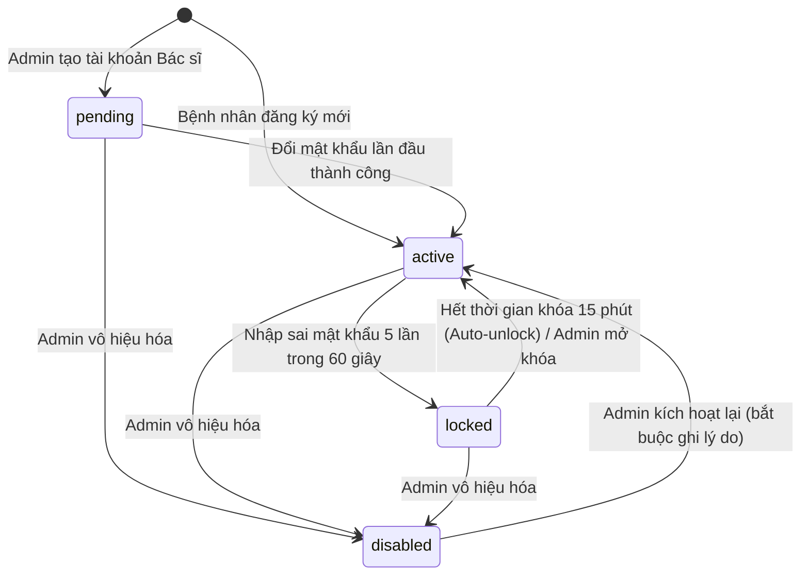

# Tài liệu Đặc tả Xác thực, Phân quyền & Kiểm toán (BR-AUTH) - MedSi Sprint 4

- **Mã việc:** S4-13
- **Người thực hiện:** Công (Luồng Xác thực & Quản trị Hệ thống)
- **Căn cứ pháp lý & Kỹ thuật:** Baseline Sprint 4 (*MedSi_Tai_lieu_thong_nhat_v0.1.md*), schema v1.1 (*medsi_schema_v1.sql*), CF-57.

---

## 1. Bảng chuyển mã quy tắc an toàn (SEC-xx -> BR-AUTH-nn) [CF-57]

Theo quyết định DL-21 (CF-57), toàn bộ các quy tắc bảo mật mang tiền tố `SEC-xx` được chuẩn hóa thành `BR-AUTH-nn`:

| Mã cũ | Mã chuẩn mới | Nội dung tóm tắt | Quyết định liên quan |
|---|---|---|---|
| SEC-01 | BR-AUTH-01 | Phân định 4 vai trò có tài khoản (`patient`, `doctor`, `staff`, `admin`). `guest` không có tài khoản DB. | DL-02 |
| SEC-02 | BR-AUTH-02 | Giới hạn đăng nhập: 5 lần sai trong 60 giây, khóa 15 phút (`locked_until`), thu hồi toàn bộ token cá nhân, thông báo lỗi chung không lộ email. | DL-15, CF-52 |
| SEC-03 | BR-AUTH-03 | Quản lý phiên bằng Laravel Sanctum (`personal_access_tokens`), thu hồi token khi đăng xuất hoặc khóa tài khoản. | DL-02 |
| SEC-04 | BR-AUTH-04 | Đổi mật khẩu lần đầu: Tài khoản bác sĩ do Admin tạo ở trạng thái `pending`, bắt buộc đổi mật khẩu mới chuyển sang `active`. | DL-02 |
| SEC-05 | BR-AUTH-05 | Kiểm soát phạm vi nhân viên cơ sở (`staff`): Bắt buộc gắn `hospital_id`, chỉ thao tác và check-in lịch thuộc cơ sở được gán. | DL-02, DL-09, CF-46 |
| SEC-06 | BR-AUTH-06 | Bác sĩ chỉ truy cập và thao tác trên lịch của chính mình (`doctors.user_id = auth->id`). Không có quyền truy cập trang quản trị. | DL-02 |
| SEC-07 | BR-AUTH-07 | Bệnh nhân chỉ xem và quản lý hồ sơ, lịch khám của chính mình (`user_id = auth->id`). | DL-02, DL-14 |
| SEC-08 | BR-AUTH-08 | Không dùng tài khoản / vai trò Kiosk độc lập; check-in thực hiện bởi nhân viên cơ sở (`staff`) hoặc Admin. | DL-02, CF-25 |
| SEC-09 | BR-AUTH-09 | Giới hạn quyền huỷ lịch: Bệnh nhân chỉ được huỷ trực tuyến khi còn từ 24 giờ trước giờ khám; dưới 24 giờ phải qua Admin can thiệp. Bác sĩ huỷ khi nghỉ đột xuất. Staff không được huỷ lịch. | DL-07, CF-40 |
| SEC-10 | BR-AUTH-10 | Admin chỉ được can thiệp trạng thái (demo thanh toán, duyệt thay bác sĩ) khi bật chế độ demo hoặc có lý do nghiệp vụ bắt buộc. | DL-03, CF-34 |
| SEC-11 | BR-AUTH-11 | Token mã QR check-in (`qr_token`) phát hành dưới dạng JWT HMAC-SHA256, độ dài 512 ký tự, không thể đoán trước và chỉ dùng trong ngày khám. | DL-26 |
| SEC-12 | BR-AUTH-12 | Tính toàn vẹn của giao dịch thanh toán: `transaction_code` unique, xử lý callback idempotent, ngăn chặn ghi nhận trùng. | DL-13, CF-19 |
| SEC-13 | BR-AUTH-13 | Bảng nhật ký kiểm toán `audit_logs` chỉ hỗ trợ thao tác INSERT (Append-only); cấm UPDATE/DELETE trên DB. | DL-14 |
| SEC-14 | BR-AUTH-14 | Bảo mật dữ liệu nhạy cảm: Không ghi CCCD, mật khẩu, mã PIN, mã QR token, mã thẻ nguyên văn vào `audit_logs` hay trả về API công khai. | DL-14, CF-50 |

---

## 2. Máy trạng thái tài khoản người dùng (`AUTH_STM`)

Tài khoản người dùng trong bảng `users` được quản lý nghiêm ngặt qua 4 trạng thái: `pending`, `active`, `locked`, `disabled`.

### Bảng đặc tả chuyển trạng thái tài khoản:

| Trạng thái hiện tại | Sự kiện kích hoạt | Trạng thái tiếp theo | Tác nhân | Điều kiện & Hành vi hệ thống |
|---|---|---|---|---|
| Không có (Mới) | Tạo tài khoản bác sĩ | `pending` | Admin | Tạo bản ghi `users` với `role='doctor'`, `status='pending'`, liên kết `doctors.user_id`. Ghi log AU-20. |
| Không có (Mới) | Đăng ký tài khoản | `active` | Bệnh nhân | Đăng ký trực tuyến, mã hoá mật khẩu BCRYPT. Ghi log AU-01. |
| `pending` | Đổi mật khẩu lần đầu | `active` | Bác sĩ | Cung cấp đúng mật khẩu tạm và mật khẩu mới (min 8 ký tự). Đổi trạng thái sang `active`, ghi log AU-05. |
| `active` | Sai mật khẩu 5 lần / 60s | `locked` | Hệ thống | RateLimiter ghi nhận 5 hits; gán `locked_until = now() + 15m`, `failed_login_count = 5`. Thu hồi toàn bộ Sanctum token, ghi log AU-03. |
| `locked` | Hết hạn khóa (15 phút) | `active` | Hệ thống (Tự động) | Khi người dùng đăng nhập lại sau mốc `locked_until`: tự động reset `failed_login_count = 0`, `locked_until = NULL`, status thành `active`. |
| `locked` | Admin mở khóa trước hạn | `active` | Admin | Admin mở khóa thủ công trong màn quản trị tài khoản. Bắt buộc lý do, ghi log AU-20. |
| `pending` / `active` / `locked` | Khóa tài khoản vi phạm | `disabled` | Admin | Thu hồi token ngay lập tức; chặn mọi truy cập API. Bắt buộc lý do, ghi log AU-20. |
| `disabled` | Mở lại tài khoản | `active` | Admin | Khôi phục quyền truy cập sau khi xem xét khiếu nại. Bắt buộc lý do, ghi log AU-20. |

---

## 3. Danh mục 20 sự kiện kiểm toán hệ thống (`AUTH_AUDIT`)

Nhật ký kiểm toán lưu trữ trong bảng `audit_logs`. Hệ thống chỉ cho phép INSERT, không chỉnh sửa hay xoá. Mọi trường thông tin nhạy cảm (CCCD, mật khẩu, QR token, BHYT) đều được che bằng `***MASKED***` trước khi lưu trữ.

| Mã sự kiện | Tên sự kiện | Tác nhân (`actor_type`) | Thực thể (`entity_type`) | Dữ liệu ghi nhận (`changes`) | Quy tắc bảo vệ dữ liệu nhạy cảm |
|---|---|---|---|---|---|
| **AU-01** | Đăng ký tài khoản | `user` | `user` | `email`, `role`, `status` | Che mật khẩu |
| **AU-02** | Đăng nhập thành công | `user` | `user` | `email`, `role`, `ip_address` | Không ghi token nguyên văn |
| **AU-03** | Đăng nhập thất bại / Khóa tài khoản | `system` / `user` | `user` | `email`, `attempts`, `locked_until` | Che mật khẩu đã nhập, không lộ email tồn tại |
| **AU-04** | Đăng xuất phiên làm việc | `user` | `user` | `user_id`, `token_id` | Hủy token trong `personal_access_tokens` |
| **AU-05** | Đổi mật khẩu | `user` | `user` | `user_id`, `status` | Tuyệt đối không ghi mật khẩu cũ/mới |
| **AU-06** | Tạo hồ sơ bệnh nhân | `user` | `patient_profile` | `profile_id`, `full_name`, `dob`, `gender` | Che 6 số giữa CCCD, che SĐT |
| **AU-07** | Cập nhật hồ sơ bệnh nhân | `user` | `patient_profile` | Các trường thay đổi | Che CCCD, BHYT, SĐT |
| **AU-08** | Xoá / Lưu trữ hồ sơ | `user` | `patient_profile` | `profile_id`, `action_type` (archive/delete) | Không ghi dữ liệu CCCD/BHYT |
| **AU-09** | Xác nhận / Rút đồng ý dữ liệu | `user` | `patient_consent` | `profile_id`, `policy_version`, `is_agreed` | Ghi IP, User-Agent, không chứa CCCD |
| **AU-10** | Tạo lịch khám mới (T01) | `user` / `admin` | `booking` | `booking_id`, `code`, `slot_id`, `status` | Snapshot bệnh nhân đã được che |
| **AU-11** | Hủy lịch khám (T04/T08/T10/T13) | `user` / `doctor` / `admin` | `booking` | `booking_id`, `reason_code`, `reason`, `refund_amount` | Bắt buộc có lý do |
| **AU-12** | Duyệt / Từ chối lịch bác sĩ (T05/T06) | `doctor` / `admin` | `booking` | `booking_id`, `decision`, `reason` | Ghi nhận ID bác sĩ thực hiện |
| **AU-13** | Lịch hết hạn giữ chỗ / duyệt (T03/T07) | `system` | `booking` | `booking_id`, `event` (T03/T07), `status` | Tự động hóa qua Job lịch |
| **AU-14** | Tiếp nhận & Check-in QR (T09) | `staff` / `admin` | `booking` | `booking_id`, `ticket_id`, `hospital_id` | Tuyệt đối không ghi chuỗi `qr_token` |
| **AU-15** | Hoàn thành ca khám (T12) | `doctor` / `admin` | `booking` | `booking_id`, `completed_at` | Ghi nhận ID bác sĩ/admin |
| **AU-16** | Xác nhận vắng mặt No-show (T11) | `admin` | `booking` | `booking_id`, `reason`, `threshold` | Ghi nhận admin xác nhận |
| **AU-17** | Giao dịch thanh toán / Demo | `gateway` / `admin` | `payment_transaction` | `transaction_code`, `amount`, `source`, `status` | Không lưu thông tin thẻ/tài khoản ngân hàng |
| **AU-18** | Yêu cầu / Duyệt hoàn tiền | `system` / `admin` | `refund` | `refund_id`, `booking_id`, `amount`, `policy_case` | Ghi nhận tỷ lệ hoàn theo chính sách |
| **AU-19** | Quản lý khung giờ khám (Slot) | `doctor` / `admin` | `slot` | `slot_id`, `capacity`, `status` (available/full/blocked) | Ghi nhận thay đổi sức chứa |
| **AU-20** | Quản trị tài khoản & Tạo bác sĩ | `admin` | `user` | `target_user_id`, `doctor_id`, `action` | Bắt buộc có ID Admin thực hiện |

---

## 4. Ma trận phân quyền RBAC cập nhật theo Mục 7 Baseline

Ký hiệu:
- **T**: Tạo mới (Create)
- **X**: Xem (Read)
- **S**: Sửa / Cập nhật trạng thái (Update)
- **Xo**: Xóa / Hủy (Delete)
- **-**: Không có quyền

| STT | Nghiệp vụ / Quyền hạn | Khách (Guest) | Bệnh nhân (Patient) | Bác sĩ (Doctor) | Nhân viên cơ sở (Staff) | Admin (Quản trị viên) | Ghi chú cập nhật Baseline Sprint 4 |
|---|---|---|---|---|---|---|---|
| **I** | **XÁC THỰC & TÀI KHOẢN** | | | | | | |
| 1 | Đăng ký tài khoản (`/auth/register`) | T | - | - | - | T | Bệnh nhân tự đăng ký; Admin tạo BS |
| 2 | Đăng nhập hệ thống (`/auth/login`) | T | T | T | T | T | Kiểm tra RateLimit 5 lần/60s |
| 3 | Đăng xuất (`/auth/logout`) | - | T [của mình] | T [của mình] | T [của mình] | T [của mình] | Thu hồi Personal Access Token |
| 4 | Quên mật khẩu / Đặt lại mật khẩu | T | - | - | - | T | **ĐỂ SAU** (CF-52, Baseline mục 7) |
| 5 | Quản lý thông tin tài khoản (users) | - | X, S [của mình] | X, S [của mình] | X, S [của mình] | X, S, Xo | Admin quản lý toàn quyền |
| 6 | Quản lý hồ sơ người bệnh (profiles) | - | X, T, S, Xo [của mình] | X [bệnh nhân khám] | - | X, S, Xo | Hiệu phụ trách S4-20..23 |
| **II** | **CHUYÊN KHOA & CƠ SỞ Y TẾ** | | | | | | |
| 7 | Tra cứu danh mục chuyên khoa | X | X | X | X | X, T, S, Xo | Công khai |
| 8 | Quản lý chuyên khoa (Thêm/Sửa/Xóa) | - | - | - | - | X, T, S, Xo | Admin quản lý |
| 9 | Tra cứu cơ sở khám (hospitals) | X | X | X | X | X, T, S, Xo | Công khai |
| 10 | Cập nhật thông tin cơ sở khám | - | - | - | - | X, T, S, Xo | Chỉ Admin |
| 11 | Danh mục dịch vụ khám (exam_types) | X | X | X | X | X, T, S, Xo | Công khai |
| **III** | **BÁC SĨ & LỊCH LÀM VIỆC (SLOTS)** | | | | | | |
| 13 | Tra cứu hồ sơ bác sĩ | X | X | X | X | X, T, S, Xo | Công khai |
| 14 | Cập nhật hồ sơ bác sĩ | - | - | X, S [của mình] | - | X, T, S, Xo | Bác sĩ sửa thông tin chuyên môn |
| 15 | Xem lịch làm việc & slot trống | X | X | X [của mình] | X [tại cơ sở mình] | X | Dưới `lockForUpdate` |
| 16 | Đăng ký / Tạo khung giờ khám | - | - | T [của mình] | - | X, T, S, Xo | Bác sĩ tạo slot của mình |
| 17 | Tạm khóa / Mở khung giờ khám | - | - | S [của mình] | - | X, S, Xo | Chặn sửa khi có lịch đang giữ |
| **IV** | **ĐẶT LỊCH HẸN KHÁM (BOOKINGS)** | | | | | | |
| 18 | Đặt lịch khám mới (`/bookings`) | - | T [của mình] | - | - | T | T01, giữ chỗ 15 phút |
| 19 | Xem chi tiết phiếu khám cá nhân | - | X [của mình] | X [ca phụ trách] | X [tại cơ sở mình] | X | Bác sĩ/Staff chỉ thấy phạm vi của mình |
| 20 | Hủy phiếu hẹn khám bệnh | - | S, Xo [của mình, >= 24h] | S [của mình, nghỉ đột xuất] | **- (BỎ)** | S, Xo [kể cả < 24h] | **Staff KHÔNG có quyền hủy lịch**; Bệnh nhân < 24h phải qua Admin |
| 21 | Yêu cầu đổi lịch / Dời ca khám | - | **- (BỎ)** | - | - | S | Đổi lịch là lối tắt Hủy rồi Đặt mới |
| 22 | Tiếp nhận bệnh nhân & Check-in QR | - | - | - | X, S [tại cơ sở mình] | X, S | Quét JWT QR đúng ngày, đúng cơ sở |
| 23 | Cập nhật tiến độ ca khám | - | - | S [completed] | - | X, S | **BỎ "Đang khám"**; Bác sĩ ghi Completed |
| **V** | **HỒ SƠ Y TẾ ĐIỆN TỬ (EMR)** | | | | | | |
| 26-28 | Ghi chẩn đoán, toa thuốc, cận lâm sàng | - | - | - | - | - | **NGOÀI PHẠM VI SPRINT 4** (Baseline mục 7) |
| **VI** | **THANH TOÁN & HOÀN TIỀN** | | | | | | |
| 29 | Tính toán viện phí (calculate-invoice) | - | X, T [của mình] | - | - | X | Tiền VND số nguyên do Server tính |
| 30 | Tạo giao dịch thanh toán trực tuyến | - | T [của mình] | - | - | S [Chỉ Demo] | Thêm Admin S cho chế độ demo |
| 31 | Xác nhận thu phí trực tiếp tại quầy | - | - | - | **- (BỎ)** | S [store_pay] | Bỏ thu tại quầy của Staff; thay bằng store_pay do Admin duyệt |
| 32 | Xem lịch sử hóa đơn | - | X [của mình] | - | - | X, S | Bỏ Xo |
| 33 | Xử lý hoàn tiền / Hủy giao dịch | - | X [của mình] | - | - | X, S | Bệnh nhân có quyền X xem hoàn tiền của mình; Bỏ Xo |
| 34 | Đánh giá & Viết nhận xét bác sĩ | - | - | - | - | - | **NGOÀI PHẠM VI SPRINT 4** (Baseline mục 7) |
| **VIII** | **BÁO CÁO & THỐNG KÊ** | | | | | | |
| 35 | Thống kê số lượng, doanh thu, hủy | - | - | X [thống kê mình] | X [thống kê cơ sở] | X | Bốn báo cáo Admin |
| **IX** | **QUẢN TRỊ & BẢO MẬT HỆ THỐNG** | | | | | | |
| 36 | Quản trị tài khoản, phân quyền, Audit | - | - | - | - | X, T, S, Xo | Chỉ Admin |

---

## 5. Sửa đổi và giải quyết xung đột (CF-40, CF-50, CF-52)

### 5.1. SEC-02 (CF-52): Cơ chế bảo vệ Brute-Force & Khóa tài khoản
- **Xung đột cũ:** Chưa rõ thời gian khóa tài khoản và cách đếm số lần sai.
- **Quyết định đã chốt:** Giới hạn 5 lần đăng nhập sai trong 60 giây sử dụng Laravel `RateLimiter`. Khi đạt ngưỡng:
  - Cập nhật `users.status = 'locked'`, `locked_until = now()->addMinutes(15)`, `failed_login_count = 5`.
  - Thu hồi toàn bộ Sanctum Personal Access Tokens hiện có của tài khoản.
  - Phản hồi HTTP 423 / 403 kèm thông báo số phút còn lại: `"Tài khoản đang bị tạm khóa. Vui lòng thử lại sau X phút."`
  - Tự động mở khóa (auto-unlock) khi người dùng thử lại sau khi mốc `locked_until` đã qua.
  - Thông báo lỗi khi nhập sai luôn là thông báo chung `"Thông tin đăng nhập không chính xác."` để chống dò quét email tồn tại.

### 5.2. SEC-09 (CF-40): Chính sách Hủy lịch & Hoàn tiền theo mốc 24 giờ
- **Xung đột cũ:** Quy định hủy lịch mâu thuẫn giữa các tài liệu miền; nhân viên quầy có quyền hủy hay không.
- **Quyết định đã chốt:**
  - Bệnh nhân tự hủy trực tuyến: Chỉ cho phép khi còn từ 24 giờ trở lên so với giờ bắt đầu khám. Hệ thống tự động tạo yêu cầu hoàn 100% phí khám, 0% phí tiện ích (PAY_POLICY dòng 1).
  - Dưới 24 giờ: Bệnh nhân không thể tự hủy trên web/app; giao diện thông báo liên hệ Admin hỗ trợ. Admin thực hiện hủy hộ (S4-35), hệ thống tạo yêu cầu hoàn 50% phí khám, 0% phí tiện ích (PAY_POLICY dòng 2).
  - Bác sĩ hủy do nghỉ đột xuất: Bắt buộc nhập lý do, hệ thống khóa slot bị ảnh hưởng, tạo yêu cầu hoàn 100% cả phí khám và phí tiện ích (PAY_POLICY dòng 3).
  - Nhân viên cơ sở (`staff`): Tuyệt đối không có quyền hủy bất kỳ lịch khám nào.

### 5.3. SEC-14 (CF-50): Che giấu thông tin định danh cá nhân (PII)
- **Xung đột cũ:** Việc lưu trữ snapshot và nhật ký kiểm toán có thể làm lộ dữ liệu cá nhân (CCCD, BHYT, SĐT).
- **Quyết định đã chốt:**
  - `audit_logs`: Bắt buộc đi qua cơ chế làm sạch tự động `AuditLogger::sanitizeData()`, thay thế toàn bộ giá trị của các key `password`, `identity_card_number`, `cccd`, `qr_token`, `health_insurance_code` bằng chuỗi `***MASKED***`.
  - API Resources: Che số CCCD (chỉ hiện 3 số đầu và 3 số cuối), che số điện thoại (chỉ hiện 3 số đuôi), trừ khi chính chủ hồ sơ đang truy cập màn hình chỉnh sửa thông tin.

