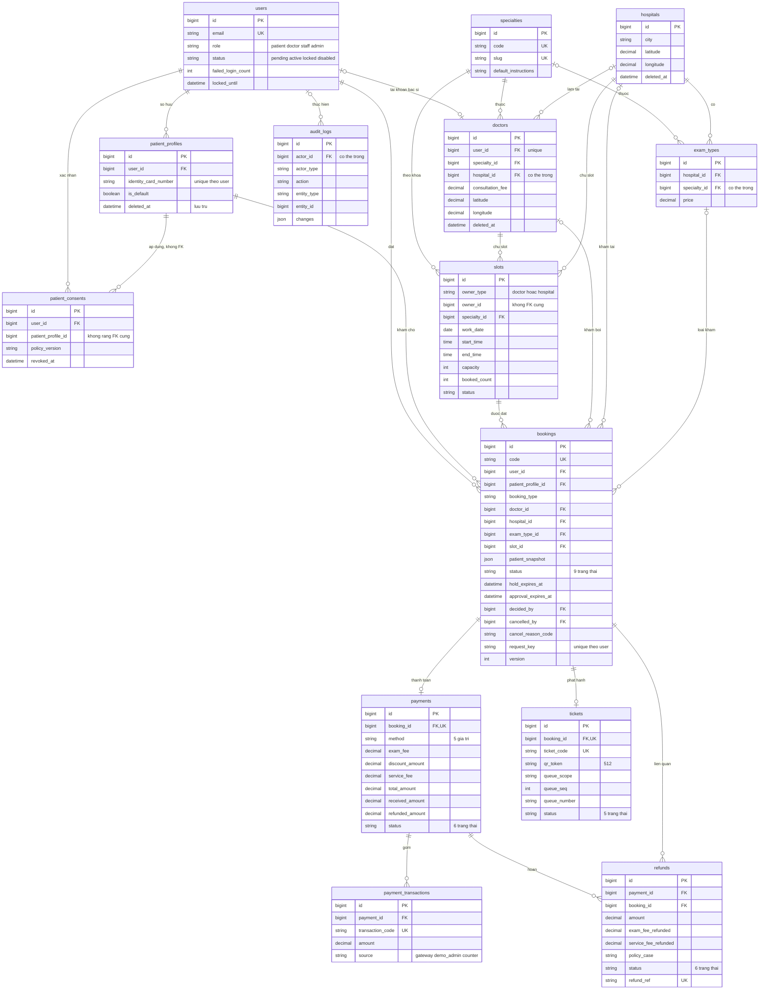

# MedSi: Tài liệu thống nhất v0.1 (baseline cho Sprint 4)

Phiên bản: v0.1 Lập ngày 31/10/2026.

Tài liệu này là nguồn sự thật duy nhất cho Sprint 4. Khi tài liệu miền mâu thuẫn với tài liệu này thì tài liệu này thắng. Muốn đổi schema, trạng thái hay tham số phải gửi một dòng vào sheet Change Requests và An duyệt trước.

Phân công đã xác nhận: **Hoài Bảo** phụ trách đặt lịch bác sĩ; **Tuấn Anh** phụ trách đặt lịch bệnh viện và phiếu khám. Tên vật lý của bảng theo code (số nhiều: `bookings`, `payments`...); tên trạng thái lưu chữ thường (`pending_payment`).

Tệp đi kèm: `medsi_schema_v1.sql` (14 bảng), `MedSi_CMN_Registers.xlsx` (rule, câu hỏi mở, xung đột, so sánh), `MedSi_Sprint4_Backlog.xlsx` (51 việc và 18 kịch bản E2E ở sheet E2E).

## 1. Quyết định đã chốt

Toàn bộ 59 xung đột (CF-01 đến CF-59) đã chốt theo đề xuất của CMN. Bảng dưới gom thành 26 quyết định.

| Mã | Chủ đề | Quyết định | Thay CF |
|---|---|---|---|
| DL-01 | Phụ trách, sprint | Hoài Bảo = bác sĩ; Tuấn Anh = bệnh viện và phiếu. Sprint 0 là khảo sát, Sprint 4 là hoàn chỉnh luồng chính | CF-58 |
| DL-02 | Vai trò | `patient`, `doctor`, `staff`, `admin`. `staff` bắt buộc gắn `hospital_id` và chỉ thao tác trong cơ sở được phân công; không có tài khoản riêng cho thiết bị check-in | CF-10, 25, 46 |
| DL-03 | Duyệt lịch | Lịch bệnh viện tự `confirmed` sau thanh toán. Lịch bác sĩ: bác sĩ duyệt trong 30 phút, hết hạn thì `expired` và hoàn tiền. Admin chỉ ghi đè khi bật chế độ demo. Bỏ “tự duyệt sau 2 giờ” | CF-34, 39 |
| DL-04 | Hạn đặt | Bác sĩ: từ 2 giờ đến 30 ngày. Bệnh viện: từ 1 ngày đến 30 ngày | CF-37 |
| DL-05 | Giữ chỗ | 15 phút cho mọi lịch, cộng 5 phút chờ khi giao dịch chưa rõ. `store_pay` có hạn riêng đến giờ khám trừ 30 phút | CF-18, 30, 38, 42 |
| DL-06 | Giới hạn lịch | Không giao giờ trên cùng hồ sơ; không cùng chuyên khoa cùng ngày; tối đa 3 lịch còn hiệu lực mỗi hồ sơ | CF-43 |
| DL-07 | Huỷ, đổi | Tự huỷ trực tuyến khi còn từ 24 giờ trước giờ bắt đầu slot (hoàn 100% phí khám). Dưới 24 giờ phải qua Admin, hoàn 50%. Bác sĩ nghỉ đột xuất huỷ được (hoàn 100% cả hai phí). Đổi lịch là huỷ rồi đặt mới | CF-21, 31, 32, 40 |
| DL-08 | Không đến khám | Mốc: lịch bác sĩ sau giờ bắt đầu slot 15 phút; lịch bệnh viện sau giờ kết thúc slot 120 phút. Hệ thống đánh dấu đủ điều kiện, Admin xác nhận; phiếu thành `expired` | CF-01, 02, 35, 44 |
| DL-09 | Tiếp nhận, hoàn thành | Nhân viên cơ sở (`staff`) tại cơ sở được phân công hoặc Admin quét QR. `completed`: bác sĩ (lịch của mình) hoặc Admin. Lịch bệnh viện thực tế dừng ở `checked_in`; bản demo cho Admin ghi `completed`. Không có trạng thái “đang khám” | CF-24, 45 |
| DL-10 | Thanh toán | Mọi lịch đều qua thanh toán. Năm giá trị `method`; bắt buộc làm QR; `store_pay` chỉ cho lịch bệnh viện, mô phỏng bằng Admin xác nhận | CF-23, 41, 42 |
| DL-11 | Phí | Phí tiện ích cố định 20.000đ trong config (đổi code từ 10.000đ). Voucher để sau (`discount_amount` = 0, trừ vào phí khám, tối đa bằng phí khám). Làm tròn nửa lên đến 1đ. Tiền VND số nguyên `DECIMAL(12,0)`, server tính | CF-27 |
| DL-12 | Hoàn tiền | Chính sách 14 dòng (mục 5). Hệ thống tự tạo yêu cầu `requested` khi T06, T07, T08, T10, T13, T16; Admin duyệt; 6 trạng thái; không xoá giao dịch | CF-17, 20, 28, 29 |
| DL-13 | Giao dịch | Bảng `payment_transactions`, `transaction_code` unique, callback idempotent. Câu chữ là “truy vấn cổng thanh toán” | CF-19, 26 |
| DL-14 | Hồ sơ | Một cơ chế xoá mềm `deleted_at`. Xoá cứng chỉ khi chưa từng có lịch; còn lịch chờ thì chặn; đã từng có lịch thì lưu trữ. Bỏ OTP. SĐT tuỳ chọn. Giám hộ khi dưới 16 tuổi (chờ kiểm chứng). Lịch lưu `patient_snapshot` đã che | CF-04 đến 08, 11, 48 đến 51 |
| DL-15 | Tài khoản | Khoá 15 phút sau 5 lần sai trong 1 phút. Quên mật khẩu và OTP để sau | CF-52 |
| DL-16 | Khu vực | Cột `city` theo danh mục tỉnh/thành hiện hành; không có cấp quận/huyện (chờ kiểm chứng nguồn) | CF-09, 55 |
| DL-17 | Số thứ tự | Khoá đếm gồm chủ slot, chuyên khoa, ngày. Cấp lúc phát hành phiếu. Cột `queue_scope` và `queue_seq` unique | CF-14, 15 |
| DL-18 | Slot | Chủ slot đa hình (`owner_type`, `owner_id`) kèm `specialty_id`. Lịch bệnh viện dùng slot cấp ca, sức chứa theo chuyên khoa. `booked_count` cập nhật dưới `lockForUpdate` | CF-16, 59 |
| DL-19 | Phạm vi | Ngoài phạm vi: bệnh án, đánh giá, voucher, hoa hồng, SMS, email, hoàn tiền thật | CF-22, 54 |
| DL-20 | Trạng thái lịch | Chuẩn 9 trạng thái ở mục 3; mọi tài liệu dùng đúng tên | CF-47 |
| DL-21 | Mã chuẩn | `SEC-nn` thành `BR-AUTH-nn`; `AUTH-OQ-nn` thành `OQ-AUTH-nn`; `UI_OQ_nn` thành `OQ-UI-nn`; `OQ-nn` của ADM thành `OQ-ADM-nn`; `UC-AUTH-nn`, `UC-ADM-nn`; `SE001` cho ngoại lệ lịch; `EX-PAY-13` | CF-13, 26, 57 |
| DL-22 | So sánh đối thủ | Chỉ giữ nhận định có ảnh chụp có ngày hoặc liên kết; bỏ điểm tự chấm | CF-56 |
| DL-23 | RBAC | Sửa theo mục 7 | CF-20 đến 24, 32 |
| DL-24 | Múi giờ | `app.timezone` = Asia/Ho_Chi_Minh; `work_date` và giờ slot là giờ địa phương | mới |
| DL-25 | Báo cáo admin | Bốn báo cáo; doanh thu ròng = tổng thu thành công trừ tổng hoàn thành công | CF-53 |
| DL-26 | QR | `qr_token` là JWT HMAC-SHA256, cột dài 512 ký tự (255 có thể không đủ) | mới |

## 2. ERD hợp nhất v1.1

Sơ đồ chỉ vẽ cột khoá và cột quan trọng; đầy đủ cột nằm trong `medsi_schema_v1.sql`. Khác với ERD v1.0 trong tài liệu CMN: thêm `slots.specialty_id`; `payments.received_amount`; `bookings.version`; `tickets.queue_scope`, `queue_seq`; tiền đổi sang `DECIMAL(12,0)`; `qr_token` 512 ký tự; `payments.method` cho phép trống đến khi chọn; thêm các ràng buộc CHECK.

**Ràng buộc quan trọng:**

| Ràng buộc | Nơi thực thi | Lý do |
|---|---|---|
| `booked_count` ≤ `capacity`; `capacity` ≥ 1; giờ bắt đầu < giờ kết thúc | CHECK trong DB | Không bán quá chỗ |
| (`owner_type`, `owner_id`, `specialty_id`, `work_date`, `start_time`) unique | UNIQUE | Không trùng slot |
| `booking_type` khớp `doctor_id`, `hospital_id`, `exam_type_id` | CHECK; nếu MySQL từ chối vì cột có khoá ngoại thì chuyển sang Form Request | Toàn vẹn lịch |
| (`user_id`, `request_key`) unique | UNIQUE (NULL được bỏ qua) | Chống bấm hai lần |
| Một `payments` cho một lịch; `transaction_code` unique; `refund_ref` unique | UNIQUE | Callback idempotent |
| `total_amount` = phí khám − giảm + tiện ích; `refunded_amount` ≤ `received_amount` | CHECK | Tiền luôn đúng |
| `refunds.amount` = hoàn phí khám + hoàn phí tiện ích | CHECK | Tách hai loại phí |
| `tickets`: một phiếu mỗi lịch; `ticket_code` unique; (`queue_scope`, `queue_seq`) unique | UNIQUE | STT không trùng |
| (`user_id`, `identity_card_number`) unique | UNIQUE (NULL được bỏ qua) | Không trùng hồ sơ |
| Một hồ sơ mặc định mỗi tài khoản; tối đa 10 hồ sơ; tối đa 3 lịch hiệu lực mỗi hồ sơ; không giao giờ; không cùng chuyên khoa cùng ngày | Service (MySQL không có chỉ mục một phần) | Quy tắc nghiệp vụ |
| Mọi khoá ngoại RESTRICT, trừ `exam_types` → `hospitals` | FK | Không xoá cứng dữ liệu lịch sử |
| Khoá dòng `slots` khi đặt và khi huỷ | Service (`lockForUpdate`) | Chống đặt trùng |
| `audit_logs` chỉ thêm | Service, tài khoản DB chỉ có quyền INSERT | Nhật ký không sửa được |

**Kiểm tra đã làm:** 35 trên 35 kiểm tra đạt trên bản SQLite tương đương sinh từ cùng một đặc tả (3 kịch bản E01, E02, E05; 23 trường hợp phải bị từ chối; 7 trường hợp phải được phép; truy vấn “gần tôi” và truy vấn job hết hạn). **Chưa chạy trên MySQL thật.** An cần chạy `migrate:fresh` và đối chiếu; cần lưu ý ENUM, CHECK (MySQL 8.0.16 trở lên) và giới hạn CHECK trên cột có khoá ngoại.

## 3. Bảng chuyển trạng thái lịch khám

`booked_count` chỉ trừ 1 khi lịch rời `pending_payment`, `pending_approval` hoặc `confirmed` để sang `expired`, `rejected` hoặc `cancelled`. Mục này thay dòng T13 của bảng ở tài liệu CMN (mục 7.6): T13 không trừ.

| Mã | Chuyển | Sự kiện, điều kiện | Ai | `booked_count` | Phiếu | Thanh toán, hoàn tiền |
|---|---|---|---|---|---|---|
| T01 | → `pending_payment` | Tạo lịch hợp lệ, còn chỗ | Bệnh nhân, Admin | +1 | Chưa có | Tạo `payments` `pending` |
| T02 | `pending_payment` → `pending_approval` | Thanh toán thành công trong hạn (lịch bác sĩ) | Hệ thống, Admin (demo) | Giữ | Chưa có | `paid`; đặt hạn duyệt 30 phút |
| T02H | `pending_payment` → `confirmed` | Thanh toán thành công trong hạn (lịch bệnh viện) | Hệ thống | Giữ | Tạo `issued`, cấp STT | `paid` |
| T03 | `pending_payment` → `expired` | Hết hạn giữ và hết thời gian chờ | Job | −1 | Chưa có | Không hoàn nếu chưa thu |
| T04 | `pending_payment` → `cancelled` | Bệnh nhân huỷ khi chưa trả | Bệnh nhân | −1 | Chưa có | `cancelled` |
| T05 | `pending_approval` → `confirmed` | Bác sĩ chấp nhận | Bác sĩ, Admin (demo) | Giữ | Tạo `issued`, cấp STT | Không đổi |
| T06 | `pending_approval` → `rejected` | Bác sĩ từ chối, bắt buộc lý do | Bác sĩ, Admin (demo) | −1 | Chưa có | Tạo hoàn 100% cả hai phí |
| T07 | `pending_approval` → `expired` | Hết hạn duyệt 30 phút | Job | −1 | Chưa có | Tạo hoàn 100% cả hai phí |
| T08 | `pending_approval` → `cancelled` | Bệnh nhân huỷ (còn từ 24 giờ) hoặc Admin huỷ hộ | Bệnh nhân, Admin | −1 | Chưa có | Hoàn theo dòng 1 hoặc 2 |
| T09 | `confirmed` → `checked_in` | Quét QR hợp lệ, đúng ngày | Nhân viên cơ sở (`staff`) thuộc cơ sở của lịch, Admin | Giữ | `issued` → `checked_in` | Không đổi |
| T10 | `confirmed` → `cancelled` | Bệnh nhân huỷ từ 24 giờ; Admin huỷ hộ dưới 24 giờ; bác sĩ nghỉ đột xuất; cơ sở đóng cửa | Bệnh nhân, Bác sĩ, Admin | −1 | → `cancelled` | Hoàn theo dòng 1, 2, 3, 4, 14 |
| T11 | `confirmed` → `no_show` | Đủ mốc (DL-08) và Admin xác nhận | Admin | Giữ | → `expired` | Hoàn 0 (dòng 12) |
| T12 | `checked_in` → `completed` | Kết thúc khám | Bác sĩ (lịch của mình), Admin | Giữ | → `completed` | Không đổi |
| T13 | `checked_in` → `cancelled` | Cơ sở ngừng phục vụ, bắt buộc lý do | Admin | Giữ | → `cancelled` | Hoàn 100% cả hai phí |
| T14 | Không đổi (`pending_payment`) | Thanh toán lỗi khi còn hạn | Hệ thống | Giữ | Chưa có | Ghi giao dịch lỗi, cho thử lại |
| T15 | Không đổi | Callback lặp cùng `transaction_code` | Hệ thống | Giữ | Không đổi | Trả kết quả cũ |
| T16 | Không đổi (đã đóng) | Tiền đến muộn hoặc khoản thu thứ hai | Hệ thống | Giữ | Không đổi | Ghi giao dịch, tạo hoàn toàn phần |

**Máy trạng thái khác:**

| Thực thể | Chuyển hợp lệ |
|---|---|
| Phiếu | `issued` → `checked_in`, `cancelled`, `expired`; `checked_in` → `completed`, `cancelled` |
| Thanh toán | `pending` → `paid`, `failed`, `cancelled` (giả định, chờ STM-PAY-01); `failed`, `cancelled` → `expired` hoặc `paid` (thu muộn); `paid` → `paid` (hoàn một phần) hoặc `refunded`; `refunded` → `paid` (nhận thêm tiền) |
| Hoàn tiền | `requested` → `approved`, `rejected`; `approved` → `processing`; `processing` → `succeeded`, `failed`, hoặc giữ `processing` khi chưa rõ; `failed` → `approved` (duyệt lại) |
| Tài khoản | `pending` → `active`; `active` → `locked`; `locked` → `active` (hết hạn hoặc Admin mở); `pending`, `active`, `locked` → `disabled`; `disabled` → `active` (Admin, có lý do) |
| Hồ sơ | Đang dùng ⇄ lưu trữ (`deleted_at`); xoá cứng nếu chưa từng có lịch |

## 4. Tham số hệ thống (`config/medsi.php`)

| Khoá | Giá trị |
|---|---|
| `hold_minutes` | 15 |
| `grace_minutes` | 5 |
| `approval_minutes` | 30 |
| `min_lead_doctor_minutes` | 120 |
| `min_lead_hospital_days` | 1 |
| `max_advance_days` | 30 |
| `free_cancel_hours` | 24 |
| `late_cancel_refund_percent` | 50 |
| `no_show_doctor_after_start_minutes` | 15 |
| `no_show_hospital_after_end_minutes` | 120 |
| `service_fee_mode`, `service_fee_amount` | `fixed`, 20000 |
| `max_profiles_per_user` | 10 |
| `max_active_bookings_per_profile` | 3 |
| `guardian_age_threshold` | 16 (chờ kiểm chứng) |
| `login_max_attempts`, `login_window_seconds`, `lock_minutes` | 5, 60, 15 |
| `near_me_radius_options_km`, mặc định | 2, 5, 10, 20; 5 |
| `symptoms_max_length` | 500 |
| `store_pay_cutoff_minutes_before` | 30 |

## 5. Chính sách hoàn tiền (14 dòng)

“Phí khám” là phần bệnh nhân đã trả cho phí khám (phí khám trừ voucher). Hai dòng 5 và 6 là dòng mới.

| # | Tình huống | Sự kiện | Hoàn phí khám | Hoàn phí tiện ích | Ai kích hoạt | Duyệt |
|---|---|---|---|---|---|---|
| 1 | Bệnh nhân huỷ từ 24 giờ | T08, T10 | 100% | 0% | Bệnh nhân (hệ thống tạo yêu cầu) | Admin |
| 2 | Bệnh nhân huỷ dưới 24 giờ (qua Admin) | T08, T10 | 50% | 0% | Admin | Admin |
| 3 | Bác sĩ nghỉ đột xuất | T10 | 100% | 100% | Bác sĩ, Admin | Admin |
| 4 | Bệnh viện huỷ hoặc đóng cửa | T10, T13 | 100% | 100% | Admin | Admin |
| 5 | Bác sĩ từ chối | T06 | 100% | 100% | Hệ thống | Admin |
| 6 | Hết hạn duyệt sau khi đã trả | T07 | 100% | 100% | Hệ thống | Admin |
| 7 | Thanh toán lỗi, chưa thu | T14 | 0 | 0 | Hệ thống | Không |
| 8 | Báo lỗi nhưng đã thu, không cấp được lịch | T16 | 100% | 100% | Hệ thống | Admin |
| 9 | Hết hạn giữ chỗ, chưa thu | T03 | 0 | 0 | Hệ thống | Không |
| 10 | Tiền thu quá hạn hoặc lịch đã huỷ | T16 | 100% | 100% | Hệ thống | Admin |
| 11 | Hai khoản thu cho một lịch | T16 | 100% khoản dư | 100% phần tiện ích dư | Hệ thống, Admin | Admin |
| 12 | Không đến khám | T11 | 0% | 0% | Admin | Admin duyệt khiếu nại |
| 13 | Đổi lịch | T08 hoặc T10 cộng lịch mới | Theo dòng 1 hoặc 2 | 0% | Bệnh nhân | Admin |
| 14 | Cơ sở đề nghị đổi, bệnh nhân không đồng ý | T10 | 100% | 100% | Admin | Admin |

Ví dụ chuẩn: phí khám 200.000đ, tiện ích 20.000đ, tổng 220.000đ. Huỷ từ 24 giờ hoàn 200.000đ; huỷ dưới 24 giờ hoàn 100.000đ; bác sĩ từ chối hoàn 220.000đ. “5–10 ngày làm việc” chỉ là câu hiển thị.

## 6. Công thức tiền

`total_amount` = (`exam_fee` − `discount_amount`) + `service_fee`. `discount_amount` ≤ `exam_fee`. Hoàn phí khám = tỷ lệ × (`exam_fee` − `discount_amount`), làm tròn nửa lên đến 1đ. `refunded_amount` ≤ `received_amount`.

## 7. Sửa RBAC (thay đổi so với `AUTH_RBAC`)

- Dòng 4 (quên mật khẩu): để sau.
- Dòng 20 (huỷ lịch): Bệnh nhân S, Xo của mình khi còn từ 24 giờ; Bác sĩ S của mình chỉ để huỷ khi nghỉ đột xuất, bắt buộc lý do; Admin S; Nhân viên cơ sở không có quyền huỷ lịch.
- Dòng 21 (đổi lịch): Bệnh nhân bỏ quyền S; đây là lối tắt giao diện mở huỷ rồi đặt mới.
- Dòng 23: bỏ “Đang khám”; Bác sĩ S `completed` của mình; Admin S.
- Dòng 26 đến 28 (chẩn đoán, kê toa, cận lâm sàng) và dòng 34 (đánh giá): ngoài phạm vi.
- Dòng 30: thêm Admin S, ghi “chỉ chế độ demo”.
- Dòng 31: bỏ “thu phí tại quầy”; thay bằng `store_pay` do Admin xác nhận.
- Dòng 32, 33: bỏ Xo; Bệnh nhân có X [chỉ của mình] ở dòng 33.
- Nhân viên cơ sở (`staff`) chỉ thao tác trong cơ sở được gán qua `hospital_id`; phạm vi hiện tại gồm quét QR và tiếp nhận lịch, không được huỷ lịch hoặc xem dữ liệu ngoài cơ sở.

## 8. Quy trình

- **Nhánh:** `s4/<luồng>-<tên>`; một PR cho một việc; mô tả ghi mã `S4-xx`, kịch bản E2E kiểm tra, kết quả test. An gộp vào `develop`; ngày 6 gộp thử vào `main`.
- **Change Request:** đổi schema, trạng thái hoặc tham số thì thêm một dòng (ai đề xuất, đổi gì, vì sao, ảnh hưởng) vào sheet Change Requests; An duyệt trước khi code.
- **Họp:** 15 phút mỗi ngày; công việc bị chặn báo ngay trong ngày.
- **Tài liệu:** mỗi người sửa tài liệu miền theo bảng CF của mình trong 3 ngày đầu (các việc loại Tài liệu trong backlog).
